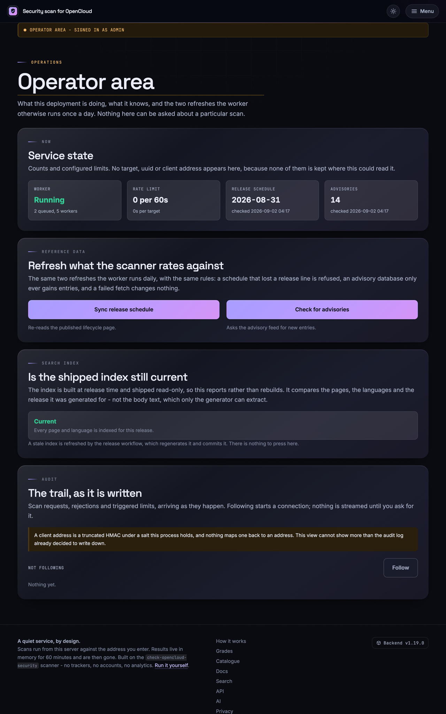
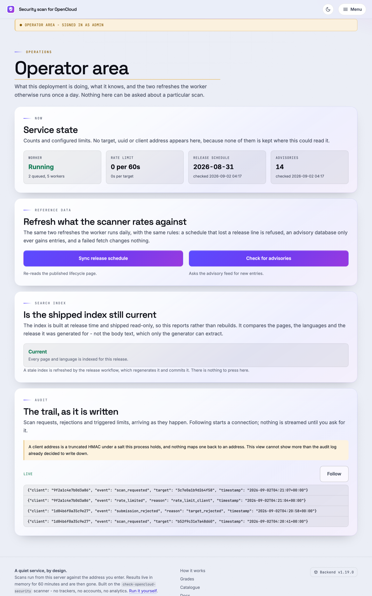

# Betrieb

Interne Hinweise für Administratoren, die dieses Repository und seine Bereitstellungen betreiben oder pflegen.

Das Dokument wird nur im freigegebenen Betreiberbereich angezeigt. Es gehört nicht in die folgenden öffentlichen Manifeste:

| Artefakt | Warum dieses Dokument fehlt |
|:--|:--|
| PyPI-Wheel | `only-include` nennt nur Plugin und `opencloud_local_scan` |
| PyPI-sdist | `include` ist eine ausdrückliche Dateiliste |
| `/documentation` | Nutzt nur `DOCUMENTATION_PAGES` in `webapp/documentation.py` |
| Öffentliche Suche | `webapp/search.py` zählt öffentliche Vorlagen ausdrücklich auf |
| Sitemap und `robots.txt` | Nutzen das öffentliche Manifest ohne Betreiberbereich |

Füge es diesen Listen nicht hinzu. Unter `/admin/docs/operations` prüft der Betreiberbereich jede Anfrage über den Outpost und antwortet allen anderen mit **404**. Sein eigenes Manifest `OPERATOR_DOCUMENTATION_PAGES` speist keine der öffentlichen Oberflächen. `tests/test_webapp_admin.py` sichert das ab.

Die beim Build erzeugten Vorlagen in `frontend/templates/admin-docs/` sind trotzdem Teil von Webpaket und Container. Das ist nur vertretbar, weil die Quellen bereits im öffentlichen Repository stehen. **Dieses Dokument darf keine Geheimnisse enthalten.**

Entwicklungsregeln stehen in `AGENTS.md`, Scan-Probleme in `docs/troubleshooting.md`. Hier geht es um aktuelle Daten, generierte Dateien und den Betrieb des Dienstes.

## Inhalt {#contents}

- [Die beiden grundlegenden Datendateien](#the-two-data-files-everything-depends-on)
- [Was sich wann aktualisiert](#what-updates-itself-and-when)
- [Schwachstellendatenbank aktualisieren](#updating-the-vulnerability-database)
- [Release-Zeitplan für neue OpenCloud-Versionen aktualisieren](#updating-the-release-schedule-new-opencloud-versions)
- [Daten auf einem Monitoring-Host aktualisieren](#refreshing-data-on-a-monitoring-host)
- [Frontend-Dokumentation neu erzeugen](#rebuilding-the-frontend-documentation)
- [Suchindex neu erzeugen](#rebuilding-the-search-index)
- [Webpaket bauen](#building-the-web-bundle)
- [Lokale Instanz zum Testen des Frontends](#a-local-instance-for-testing-the-frontend)
- [Laufzeitaktualisierung des Webdienstes](#the-web-service-refreshes-itself-at-runtime)
- [Betreiberbereich unter /admin](#the-operators-area-at-admin)
- [Wo du bei Fehlern nachsiehst](#where-to-look-when-something-breaks)
- [Wenn OpenCloud seine Dokumentation verschiebt](#when-opencloud-moves-its-documentation)
- [Grenzen, die du kennen solltest](#limitations-worth-knowing-before-somebody-asks)
- [Was Administratoren niemals tun dürfen](#things-an-administrator-must-never-do)

## Die beiden grundlegenden Datendateien {#the-two-data-files-everything-depends-on}

```
opencloud_local_scan/data/vulnerabilities.json   # which versions are affected by what
opencloud_local_scan/data/release_schedule.json  # which release lines are still supported
```

Jede Bewertung beginnt mit diesen Dateien. Veraltete Advisories können eine verwundbare Instanz als sicher erscheinen lassen; ein veralteter Zeitplan kann Supportende als unbekannt ausgeben. Behandle beides als sicherheitsrelevante Daten.

CI aktualisiert die Dateien per Pull Request; ein Mensch prüft den Merge. In Produktion werden sie nicht überschrieben.

## Was sich wann aktualisiert {#what-updates-itself-and-when}

| Workflow | Zeitpunkt (UTC) | Aufgabe |
|:--|:--|:--|
| `vulnerability-db.yml` | täglich 05:41 | OSV einlesen, bei Änderungen PR öffnen |
| `release-schedule.yml` | montags 04:17 | Lebenszyklus einlesen, PR mit JSON und README-Block |
| `check-opencloud-links.yml` | dienstags 05:41 | Dokumentierte OpenCloud-Links prüfen |
| `supply-chain.yml` | montags 04:17 | Abhängigkeiten und Lieferkette prüfen |
| `bandit.yml` | mittwochs 17:38 | Statische Sicherheitsanalyse |
| `integration-opencloud-container.yml` | samstags 03:17 | Echten OpenCloud-Container scannen |
| `attest-security-data.yml` | Datenänderung auf `main` | Dateien mit Sigstore signieren |

Die ersten drei unterstützen `workflow_dispatch`. Starte sie normalerweise über Actions. Lokale Skripte helfen bei defektem Workflow, Offline-Arbeit oder zur Prüfung des Diffs vor dem PR.

## Schwachstellendatenbank aktualisieren {#updating-the-vulnerability-database}

```bash
python scripts/update_vulnerability_db.py             # fetch and write
python scripts/update_vulnerability_db.py --check     # report only, write nothing
```

| Flag | Standard | Zweck |
|:--|:--|:--|
| `--url` | `https://api.osv.dev/v1/query` | Spiegel oder interner Feed |
| `--package` | `github.com/opencloud-eu/opencloud` | Anderes Modul abfragen |
| `--timeout` | `30` | Sekunden |
| `--check` | aus | Bei veralteter Datei ungleich null beenden, nichts schreiben |
| `--allow-failure` | aus | Bei unerreichbarem Feed mit `0` beenden |

**Aktualisierungen ergänzen nur.** Ein vom Feed vergessenes Advisory ist nicht behoben und bleibt erhalten. Nur eine bewusste manuelle Änderung entfernt Einträge oder ergänzt OSV unbekannte Meldungen.

Prüfe vor dem Commit auf neue Einträge und ergänzte Bereiche. Verschwundene Einträge oder Meldungen ohne Versionsbereich sind Warnzeichen: Letztere würden jede Version betreffen.

## Release-Zeitplan für neue OpenCloud-Versionen aktualisieren {#updating-the-release-schedule-new-opencloud-versions}

Dieses Skript liest neu veröffentlichte Versionen ein:

```bash
python scripts/update_release_schedule.py             # fetch, write JSON + README block
python scripts/update_release_schedule.py --check     # report only
python scripts/update_release_schedule.py --no-readme # leave the README block alone
```

| Flag | Standard | Zweck |
|:--|:--|:--|
| `--url` | `https://docs.opencloud.eu/docs/admin/resources/lifecycle/` | Lebenszyklusseite oder Spiegel |
| `--timeout` | `30` | Sekunden |
| `--check` | aus | Bei veralteten Daten ungleich null beenden |
| `--no-readme` | aus | Nur JSON schreiben |
| `--allow-failure` | aus | Bei Abruf- oder Parsefehler mit `0` beenden |

Es schreibt **beides**: `opencloud_local_scan/data/release_schedule.json` und den README-Block zwischen `<!-- release-schedule:start -->` und `<!-- release-schedule:end -->`.

- Bearbeite den Block nicht von Hand; der nächste Lauf überschreibt ihn. `tests/test_update_script.py` prüft die Übereinstimmung.
- Fehlende Markierungen sind ein Fehler; das Update darf nicht still ausfallen.
- Die handgeschriebenen Texte und Beispiele um den Block nennen bewusst ältere Versionen und bleiben unverändert.

Nur die Lebenszyklusseite nennt den Release-Typ. GitHub-Releases unterscheiden Rolling und Production nicht; bei Ausfall bleibt der bisherige Zeitplan erhalten. **Neuere Versionen können weniger unterstützt sein als ältere**, weil Rolling, Production und LTS parallel laufen.

## Daten auf einem Monitoring-Host aktualisieren {#refreshing-data-on-a-monitoring-host}

Das installierte Plugin enthält die Daten seines Releases. Dazwischen kannst du geprüfte Daten ohne Paketupgrade beziehen:

```bash
check-opencloud-scanner refresh-data
# ~/.cache/check-opencloud-security/release_schedule.json
# ~/.cache/check-opencloud-security/vulnerabilities.json
```

| Flag | Standard | Zweck |
|:--|:--|:--|
| `--output-dir` | `~/.cache/check-opencloud-security` | Zielverzeichnis der JSON-Dateien |
| `--schedule-url` | nicht gesetzt | Lebenszyklusseite direkt abrufen |
| `--advisory-url` | nicht gesetzt | OSV oder Spiegel direkt abfragen |
| `--timeout` | `30` | Sekunden |

**Ohne URL** stammen die Dateien aus dem geprüften `main` dieses Projekts. Vor ihrer Nutzung wird eine Sigstore-Attestierung geprüft (ADR 0027). Das ist der empfohlene Weg.

**Mit URL** wird die Quelle ohne Signatur direkt abgefragt. Es gelten nur Strukturprüfungen, und der Befehl warnt davor. Nutze das für interne Spiegel oder Forks, nicht als vermeintlich aktuellere Alternative.

In beiden Fällen werden Zeitpläne mit verlorenen bekannten Linien und Advisory-Datenbanken ohne brauchbare begrenzte Bereiche abgelehnt.

Die Vertrauenskette: Update-Workflow öffnet PR, Mensch merged, `attest-security-data.yml` signiert die Dateien auf `main` mit einem kurzlebigen, an die Workflow-Identität gebundenen Sigstore-Zertifikat. Es gibt keinen dauerhaft geheimen Signierschlüssel. `opencloud_local_scan/data_signing.py` prüft Aussteller, Workflow-Pfad und Ref und lehnt nicht passende vorhandene Attestierungen ab.

Verweise danach in der Konfiguration auf die Dateien:

```yaml
scanner:
  release_schedule: /var/lib/check-opencloud-security/release_schedule.json
  vulnerability_db:
    - /var/lib/check-opencloud-security/vulnerabilities.json
```

Alternativ: `COS_SCANNER_RELEASE_SCHEDULE`, `COS_SCANNER_VULNERABILITY_DB`, Listen mit `;`. Rangfolge: **CLI > Umgebung > Datei > Standard**. Aktualisiere täglich per Cron vor den Scans und alarmiere bei einem Exit-Code ungleich null.

## Frontend-Dokumentation neu erzeugen {#rebuilding-the-frontend-documentation}

`/documentation` ist ein **Build-Artefakt**. Produktion liefert eingecheckte HTML-Vorlagen ohne Markdown-Parser aus.

```bash
python scripts/build_frontend_documentation.py           # regenerate
python scripts/build_frontend_documentation.py --check   # fail if stale (CI runs this)
```

- Quellen: `README.md`, `opencloud_local_scan/README.md` und ausgewählte `docs/`-Dateien aus `webapp/documentation.py`.
- Ausgabe: `frontend/templates/docs/*.html` und Sprachunterverzeichnisse.
- Nach Quellenänderungen neu erzeugen und mitcommitten; CI lehnt veraltete Ausgaben ab.
- Generiertes HTML nie von Hand bearbeiten.

Öffentliche Anleitungen haben englische, deutsche, französische und spanische Quellen (`docs/`, `docs/de/`, `docs/fr/`, `docs/es/`; ADR 0063). Eine Sprache ohne Quelle erhält Englisch mit `lang="en"` und übersetzter Oberfläche. Betreibertexte stehen zusätzlich unter `docs/<Sprache>/operator/`; ADR-Originale bleiben Englisch.

## Suchindex neu erzeugen {#rebuilding-the-search-index}

```bash
python scripts/build_search_index.py            # regenerate
python scripts/build_search_index.py --check    # fail if stale
```

Ausgabe:

```
frontend/static/search-index.json      # English: every page and its text
frontend/static/search-index.de.json   # overlays: translated chrome only
frontend/static/search-index.es.json
frontend/static/search-index.fr.json
```

Die öffentliche Vorlagenliste in `webapp/search.py` ist ausdrücklich begrenzt. Der Generator hat keinen Datenspeicher, API-Zugriff, Ergebnis- oder Exportvorlagen, UUIDs oder Netzwerkeingaben. Ergebnisse und Zieladressen können daher nicht in den Index gelangen. Regulär aktualisiert ihn der Release-Workflow. Übersetzte Betreibertexte gehen ausschließlich in den geschützten Betreiberindex.

## Webpaket bauen {#building-the-web-bundle}

Die Webanwendung wird nie über PyPI ausgeliefert, sondern als Tarball:

```bash
python scripts/build_web_bundle.py
# dist/check_opencloud_security_web.tar.gz  (+ .sha256)
```

Führe den Build nach Änderungen an `webapp/` oder `frontend/` aus; er gehört nicht zu `pytest`. `tests/test_webapp_packaging.py` baut echte Artefakte und verhindert, dass diese Verzeichnisse ins Wheel oder sdist gelangen.

## Lokale Instanz zum Testen des Frontends {#a-local-instance-for-testing-the-frontend}

Ein entfernbarer Stack aus Webanwendung, Worker und Redis baut deinen Arbeitsstand für die Browserprüfung vor der Veröffentlichung.

### Mit einem Befehl {#the-one-command-version}

Für den unveränderten ausgelieferten Stack:

```bash
cd docker
docker compose up --build
# http://127.0.0.1:8811
```

`docker/docker-compose.yml` baut bereits mit `context: ..` aus der Repository-Wurzel. `COS_WEB_ALLOW_PRIVATE_TARGETS: "false"` sperrt jedoch private, Loopback- und Link-Local-Adressen. Die Seite funktioniert, lokale Testziele werden abgelehnt.

### Mit dem empfohlenen Assistenten {#the-wizard-version-which-is-the-one-you-want}

`docker/setup-wizard.py` erzeugt den passenden Stack. Er ist eigenständig, nutzt nur die Standardbibliothek und ist vom Plugin-Assistenten `--configure` unabhängig.

```bash
cd docker
./setup-wizard.py \
    --non-interactive \
    --preset private \
    --image-source build \
    --output-dir ~/scan-test \
    --compose-file docker-compose.local.yml \
    --env-file .env.local
```

| Flag | Bedeutung |
|:--|:--|
| `--preset private` | Erlaubt private Ziele, schaltet Indexierung aus und Audit ein |
| `--non-interactive` | Übernimmt Standards und erzeugt Zugangsdaten; ohne Flag fragt er mit Erläuterungen nach |
| `--image-source build` | Baut den Checkout statt des standardmäßigen Docker-Hub-Images |
| `--output-dir ~/scan-test` | Schreibt außerhalb des Repositorys |
| `--compose-file` / `--env-file` | Eigene Namen; `docker-compose.yml`, `docker-compose.dockerhub.yml`, `docker-compose.authentik.yml`, `docker-compose.monitoring.yml` werden ohne `--force` verweigert |

`build` ist ausdrücklich nötig. Der Assistent setzt den Build-Kontext als absoluten Repository-Pfad, sodass beliebige Ausgabeverzeichnisse funktionieren.

Danach:

```bash
cd ~/scan-test
docker compose -f docker-compose.local.yml up -d --build
open http://127.0.0.1:8811
```

> **Erzeuge die Dateien außerhalb des Repositorys.** `.env.local` enthält Redis-Passwort, Lösch-Token, Signierschlüssel für Löschung und Export sowie Audit-Salt. Das Muster `.env` in `.gitignore` schützt `.env.local` nicht. Ein breites `git add` könnte die Datei aufnehmen. Rechte `0600` schützen vor anderen lokalen Benutzern, nicht vor deinem Commit.

- Wiederholte Ausführung liest vorhandene Werte als Standards ein und erhält Zugangsdaten.
- Nicht interaktiv beendet ein zweiter Lauf mit `Nothing written.`, weil Überschreiben standardmäßig abgelehnt wird. Nutze `--force`, wenn du ersetzen willst.

### Schnelle Änderungen prüfen {#the-fast-edit-loop}

Für CSS- und Vorlagenänderungen bindest du das Frontend nach `/app/frontend` ein:

```yaml
# ~/scan-test/docker-compose.override.yml
services:
  web_app:
    volumes:
      - /path/to/check-opencloud-security/frontend:/app/frontend:ro
```

```bash
docker compose -f docker-compose.local.yml -f docker-compose.override.yml up -d
```

Vorlagen, `app.css` und `frontend/static/js/` werden beim nächsten Laden sichtbar. Weiterhin nötig:

- Änderungen unter `webapp/`: Image neu bauen beziehungsweise Prozess neu starten; uvicorn nutzt bewusst kein `--reload`.
- `frontend/static/llms.txt` und `llms-full.txt`: Neustart, da nur beim Start gelesen.
- `frontend/templates/docs/*.html`: aus den Quellen mit `scripts/build_frontend_documentation.py` neu erzeugen.

Mit `COS_WEB_FRONTEND_DIR` kannst du einen anderen Mountpfad wählen.

### Ein Ziel bereitstellen {#giving-it-something-to-scan}

Scans laufen **im Worker-Container**. `localhost` bezeichnet diesen Container. Für Ziele auf dem Host nutze `host.docker.internal` bei Docker Desktop oder die Hostadresse auf der Docker-Bridge. Für andere Container verbinde die Stacks über dasselbe Docker-Netz und nutze den Dienstnamen.

Ohne echte Instanz kannst du Formular, Validierung, Warteschlange, Fortschritt, abgelaufene UUIDs, Katalog, Dokumentation und statische Seiten testen. Verbindungsfehler ergeben eine fehlgeschlagene Analyse mit Fehlerseite. `tests/fake_opencloud.py` ist ein echter HTTP-Server mit `InstanceBehaviour` und liefert realistisch erzeugte Ergebnisansichten ohne OpenCloud-Installation.

### Aufräumen {#tearing-it-down}

```bash
cd ~/scan-test
docker compose -f docker-compose.local.yml down -v   # -v also drops the Redis volume
rm docker-compose.local.yml .env.local
```

Ergebnisse liegen mit TTL in Redis; die Anwendung schreibt nichts auf Platte. `down -v` entfernt auch das Redis-Volume.

## Laufzeitaktualisierung des Webdienstes {#the-web-service-refreshes-itself-at-runtime}

Mit dem Image sind die mitgelieferten Daten eingefroren. Der Worker liest beide Quellen täglich neu und hält sie in Redis für die Scans, ohne Dateien zu schreiben.

| Einstellung | Standard | Zweck |
|:--|:--|:--|
| `COS_WEB_SCHEDULE_REFRESH` | an | Tägliche Lebenszyklusabfrage |
| `COS_WEB_SCHEDULE_REFRESH_HOUR` | `4` | UTC-Stunde; zwischen Bereitstellungen variieren |
| `COS_WEB_SCHEDULE_REFRESH_URL` | Lebenszyklusseite | Alternative Quelle |
| `COS_WEB_ADVISORY_REFRESH` | an | Tägliche Advisory-Abfrage |
| `COS_WEB_ADVISORY_REFRESH_URL` | OSV | Alternative Quelle |
| `COS_WEB_ADVISORY_REPOSITORY_URL` | OpenCloud-GitHub-Advisories | Zweite Quelle; `off` deaktiviert sie |

Redis-Schlüssel:

```
cos:web:schedule:document     cos:web:schedule:checked     cos:web:schedule:attempt
cos:web:advisories:document   cos:web:advisories:checked   cos:web:advisories:attempt
```

`:checked` ändert sich nur bei **akzeptiertem** Abruf. Ein alter Wert allein unterscheidet unerreichbare Quelle und abgelehnte Daten nicht. `:attempt` hält deshalb immer den letzten Ausgang fest: `updated`, `unchanged`, `rejected`, `failed`.

- Zeitpläne müssen **jede mitgelieferte bekannte Linie** erhalten, sonst würde Supportende zu unbekannt.
- Advisories werden nur **ergänzt**; eine leere Liste ändert nichts.
- Meldungen ohne begrenzte Versionsbereiche werden niemals akzeptiert.
- Eine übermäßig große Advisory-Menge wird vollständig abgelehnt.
- Fehler lassen den bisherigen Stand unverändert.
- Nach erneuter Bereitstellung gewinnt eine neuere mitgelieferte Datei.

Untersuche bei Ablehnung die Quelldaten, statt Schutzregeln zu lockern.

## Betreiberbereich unter /admin {#the-operators-area-at-admin}

Optional und standardmäßig aus:

```bash
COS_WEB_ADMIN_ENABLED=true
COS_WEB_ADMIN_PROXY_SECRET=<32+ characters, generated>
COS_WEB_ADMIN_USERS=okko;sam
```

Der Assistent fragt diese Werte ab und erzeugt das Geheimnis in `.env`. Ein Betreiber muss sowohl in `COS_WEB_ADMIN_USERS` als auch in Authentiks Gruppe `opencloud-scanner-operators` stehen. Der Einladungslink des Assistenten erledigt beides. Manuelle Einrichtung, `akadmin`-Wiederherstellung und verpflichtender zweiter Faktor stehen in [`docs/authentik.md`](../../../docs/authentik.md#an-operator-for-admin).

**Aus bedeutet nicht vorhanden.** Ohne Aktivierung werden die Routen nicht registriert; `/admin` liefert gewöhnliches 404.

**Der Dienst authentifiziert niemanden selbst.** Authentiks Proxy meldet an und übermittelt Identitätsheader. Nur mit `COS_WEB_ADMIN_PROXY_SECRET` als `X-COS-Admin-Proxy` werden sie akzeptiert. Direkter Containerzugriff liefert ohne Header 404. Bei eigenem Reverse Proxy musst du den Header selbst sicher setzen. `authentik/blueprints/opencloud-admin.yaml` richtet Anbieter, Gruppe und Outpost ein.

Der Assistent erzeugt bei gebündeltem Authentik passende nginx-, Caddy- oder Traefik-Konfiguration: `/admin` wird zuerst vom Outpost geprüft; nur erlaubte Anfragen erhalten Identität und Proxy-Geheimnis. nginx nutzt ein nur für den Besitzer lesbares Include, Caddy und Traefik ihre Umgebung. Apache unterstützt dies nicht selbst; seine generierte Konfiguration lässt den Bereich ausdrücklich aus. Siehe [`docker/README.md`](../../../docker/README.md#the-reverse-proxy).

**Ohne durchsetzbare Anmeldung kein Start:** fehlendes oder unter 32 Zeichen langes Geheimnis sowie leere Benutzerliste verhindern den Start. Leer bedeutet niemals „alle angemeldeten Benutzer“.

Auch Abmeldung übernimmt der Anbieter. Erst mit konfiguriertem Ziel erscheint der Link:

```bash
COS_WEB_ADMIN_SIGN_OUT_URL=/outpost.goauthentik.io/sign_out
```

Der gebündelte Reverse Proxy stellt diesen Pfad bereit; der Assistent trägt ihn bei Authentik ein. Für eigene Anbieter nutze deren Abmeldeziel. Ohne Wert gibt es keinen irreführenden Abmeldelink. Zulässig sind nur lokale Pfade oder HTTP(S)-URLs; andere Werte verhindern den Start.

| Karte | Funktion |
|:--|:--|
| Dienstzustand | Worker-Lebenszeichen, Warteschlange, Limits und Alter der Referenzdaten; exakter Zeitstempel am Element, Warnung nach zwei Tageszyklen. „Unbekannt“ beim Worker bedeutet, dass Redis nicht antwortet, nicht dass der Worker ausgefallen ist |
| Funktionen der Bereitstellung | MCP und Tokenpflicht, API-Dokumentation, Indexierung, private Ziele, Verschlüsselung, Audit-Ort und Umfang. Startkonfiguration, daher ohne Polling |
| Ausschlüsse | Einzige schreibende Karte: neue Einträge sperren kommende Anfragen und bereits wartende Scans in allen Prozessen. Umgebungswerte lassen sich hier nicht entfernen |
| Referenzdaten | Dieselben `refresh_schedule` / `refresh_advisories` mit denselben Schutzregeln; standardmäßig 60 Sekunden Pause je Aktion |
| Suchindex | Prüft den ausgelieferten Index, baut ihn nie neu. Zeigt Gründe und Abhilfe. Ohne Release-Stempel ist die Textaktualität unbekannt, auch wenn Seiten und Sprachen prüfbar sind |
| Audit | Streamt vorhandene Datensätze aus der Logdatei oder einem begrenzten Ring im Prozessspeicher |

| Reiter | Inhalt |
|:--|:--|
| Konfiguration | Alle gelesenen `COS_WEB_*`-Werte nach Parsing, Begrenzung und Rückfällen; Herkunft, dokumentierte Standards und Beschreibung. Geheimnisse nur als gesetzt/nicht gesetzt. Unbekannte Variablennamen ohne Werte. Gezeigt wird die Umgebung dieses Webprozesses, nicht die von OpenCloud oder dem Worker |
| Regeln | Notenskala, Schweregradgrenzen, Supportende und Kanal, Zusatzprüfungen, Ausnahmen, Referenzdaten; Client-, Tages- und Ziellimits, Missbrauchssperren (standardmäßig 1 h → 6 h → 24 h), SSRF-Bereiche, Namen, Wildcard-DNS, Freigabemodus, Scan-Flags und Zugangsdaten-/Aktionslimits. Jede Regel nennt Status und Variablen; `webapp/rules.py` liest wirksame Werte, Tests prüfen Änderungen |
| Architektur | Aufbau und Grenzen aus `ARCHITECTURE.md` |
| Betrieb | Dieses Dokument |
| Releases | Zehn neueste Release-Abschnitte aus `CHANGELOG.md`, neuester zuerst |
| Entscheidungen | Alle in `adr/README.md` gelisteten ADRs mit Status und Filter; eigene Seiten unter `/admin/decisions/<slug>`, interne Querverweise und geschützte Volltextsuche |

Die drei Dokumente werden beim Build aus `OPERATOR_DOCUMENTATION_PAGES` nach `frontend/templates/admin-docs/` erzeugt, Architektur und Betrieb zusätzlich auf Deutsch, Spanisch und Französisch aus `docs/<Sprache>/operator/`, mit den englischen Abschnittsankern und Befehlen. Release-Texte bleiben in jeder Sprache Englisch (ADR 0078). Weder Laufzeit-Markdown noch Aufnahme in öffentliche Suche, Sitemap oder `/documentation`. Die Konfigurationsbeschreibungen erzeugt dasselbe Skript aus `docs/webapp.md` nach `webapp/environment_reference.py`; CI und `tests/test_webapp_admin_configuration.py` verhindern Abweichungen.

ADRs werden aus der Indextabelle, nicht dem Verzeichnisinhalt, nach `frontend/templates/admin-decisions/` erzeugt. `webapp/decision_records.py` trägt ihre Liste ins Webpaket, das `adr/` nicht enthält. **ADR-Texte bleiben Englisch**, ihre Oberfläche folgt der gewählten Sprache. Nach Änderungen Dokumentation und Suche neu erzeugen.

Der Bereich zeigt keine gescannten Ziele, UUIDs, Ergebnisse oder Clientadressen. Statistiken sind Zähler und Einstellungen; Audit-Fingerabdrücke sind gekürzte HMACs ohne Rückzuordnung. Nur selbst konfigurierte Ausschlüsse enthalten Adressen; `/admin/state` nennt lediglich deren Anzahl.

**Ausschlüsse sind die einzige Änderung am Dienstverhalten:**

- Sie können Scans nur verweigern, nie auslösen oder Limits erweitern.
- `COS_WEB_BLOCKED_TARGETS` ist eine nicht entfernbare Untergrenze; Änderungen daran verweisen auf die Umgebung.
- Zusätzliche Einträge liegen in Redis. Dauerhafte Sperren gehören in die Umgebung.
- Ein Eintrag ist höchstens 253 Zeichen lang, sonst könnte er kein akzeptiertes Ziel treffen.
- Verglichen werden geparste Werte: `Example.COM` und `example.com` sind derselbe Ausschluss, unabhängig von der Schreibweise.
- Bei unlesbarem Speicher wird der Scan verweigert: `503` mit übersetzter Erklärung und Audit-Ereignis `exclusions_unreadable`.

Die Begründung steht in [ADR 0044](../../../adr/0044-the-operator-area-may-write-the-exclusions.md).

Messwerte werden alle zehn Sekunden abgefragt und zeigen ihr Alter; veraltete Antworten bleiben erkennbar. Änderungen heben die Kachel hervor. Im Hintergrund pausiert Polling, beim Zurückkehren wird sofort neu gelesen.

Warnakzente betreffen riskante Kombinationen, nicht automatisch falsche Einzelwerte. Offenes MCP ist für einen öffentlichen Scanner normal; private Ziele sind für interne Überwachung nötig. Private Ziele zusammen mit öffentlicher Indexierung verdienen Prüfung; meist ist `COS_WEB_ALLOW_INDEXING=false` gemeint.

Referenzdaten zeigen relatives Alter, exakte Zeit und nach zwei Tageszyklen eine Warnung. Fehler unterscheiden Abrufproblem und Schutzregel-Ablehnung. Deaktivierte Aktualisierung gilt nicht als überfällig.

**Quellen testen** führt Abruf und Validierung aus und verwirft das Ergebnis. So unterscheidest du `failed` von `rejected`, ohne Daten zu übernehmen. Die Aktion hat einen eigenen Cooldown-Schlüssel für `COS_WEB_ADMIN_REFRESH_COOLDOWN`. Erneut lesen, Diagnose kopieren (`/admin/state`) und Audit-Anzeige leeren ändern keine gespeicherten Daten.

Audit-Streams enden nach 30 Minuten mit Hinweis; „Folgen“ öffnet einen neuen. Ohne `COS_WEB_AUDIT_LOG_FILE` siehst du nur den Speicherring der antwortenden Replik. Für die vollständige Spur konfiguriere die Datei.





Der Bereich bleibt unangekündigt: `noindex, nofollow, noarchive`, keine Sitemap, `llms.txt`, OpenAPI, öffentliche Dokumentation oder Suche. Auch kein `Disallow` in `robots.txt`, das den Pfad verraten würde.

## Wo du bei Fehlern nachsiehst {#where-to-look-when-something-breaks}

### Zuerst: `/healthz` {#first-stop-healthz}

```bash
curl -s https://your-deployment.example.com/healthz | jq
```

Liefert `status`, `version`, `queueDepth`, `worker`, `releaseSchedule`, `advisories`: Zeitpunkte, keine Ziele. **503** bedeutet meist fehlender ARQ-Worker oder verlorene Redis-Verbindung, nicht einen defekten Webprozess.

### Logger-Namen {#logger-names}

Komponenten lassen sich getrennt einstellen:

```
check_opencloud.web            check_opencloud.web.worker
check_opencloud.web.schedule   check_opencloud.web.advisories
check_opencloud.web.reference  check_opencloud.web.queue
check_opencloud.web.mcp        check_opencloud.web.mcp.auth
check_opencloud.web.runner     check_opencloud.web.audit
check_opencloud.data_signing   check_opencloud.refresh_data
```

### Suchbare Logmarkierungen {#the-markers-to-grep-for}

Scan-Lebenszyklus, jeweils nur mit UUID:

```
scan_created  scan_started  scan_completed
scan_failed   scan_timeout  scan_rejected   scan_expired
```

Referenzdaten:

```
schedule_refresh_updated    schedule_refresh_unchanged
schedule_refresh_failed     schedule_refresh_rejected
schedule_refresh_error      schedule_stored_superseded
advisory_refresh_updated    advisory_refresh_unchanged
advisory_refresh_failed     advisory_refresh_rejected
advisory_refresh_error      advisory_stored_rejected
reference_read_failed
```

`*_rejected`: Abruf erfolgreich, Inhalt abgelehnt. `*_failed`: Netzwerk- oder Parsefehler.

Zugang und Berechtigungen:

```
purge_throttled   purge_denied      api_docs_enabled
submission_cross_site               language_cross_site
mcp_auth_configured_but_endpoint_disabled
mcp_token_rejected reason=…         (DEBUG level)
forwarded_for_ignored reason=…      (DEBUG level)
```

### Was absichtlich nicht im Log steht {#what-the-logs-deliberately-do-not-contain}

**Keine Ziel-URLs, Clientadressen oder Ergebnisse.** Welches Ziel hinter einem fehlgeschlagenen Scan steckt, lässt sich bewusst nicht aus Logs bestimmen. Nutze die gemeldete UUID innerhalb ihrer TTL. Optionales Audit (`COS_WEB_AUDIT_LOG*`, `COS_WEB_AUDIT_SALT`) ist die dokumentierte Ausnahme; lies vorher `docs/webapp.md`.

### Häufige Fehlerbilder {#common-shapes-of-failure}

| Symptom | Erste Prüfung |
|:--|:--|
| `/healthz` 503 | Worker, dann `COS_WEB_REDIS_URL`. „Antwortet nicht“: Redis bestätigt fehlenden Heartbeat. „Unbekannt“: Redis selbst nicht erreichbar |
| Angenommen, aber nie abgeschlossen | Worker-Logger, Warteschlangentiefe |
| Scan-Link liefert 404 | `COS_WEB_RESULT_TTL`; unbekannt, ungültig und abgelaufen sind gleich |
| Zu gute Noten | Advisory-Aktualisierung veraltet oder abgelehnt |
| Unbekannt statt Supportende | Zeitplan veraltet oder abgelehnt |
| MCP ohne Anmeldung erreichbar | `COS_WEB_MCP_AUTH_ENABLED` und Aussteller prüfen |
| Berechtigte Nutzer limitiert | `COS_WEB_IP_RATE_LIMIT`, `COS_WEB_IP_RATE_WINDOW`, `COS_WEB_TARGET_COOLDOWN`; lange 429: `COS_WEB_PROBE_*` / `rate_limit_probe` oder `COS_WEB_DAILY_SCAN_LIMIT` / `rate_limit_daily`; 403: `COS_WEB_REQUIRE_APPROVAL`; hinter Proxy auch `COS_WEB_TRUST_FORWARDED_FOR`, `COS_WEB_TRUSTED_PROXY_HOPS` |
| Interne Ziele abgelehnt | SSRF-Schutz; private Ziele auf öffentlichen Diensten nur bewusst erlauben |

Plugin-Probleme zu UNKNOWN, Zertifikaten, Versionen, Exit-Codes und GitHub-Limits erklärt `docs/troubleshooting.md`.

## Wenn OpenCloud seine Dokumentation verschiebt {#when-opencloud-moves-its-documentation}

Lebenszyklus, Advisories, Quellcodebelege und Anleitungen verlinken externe Seiten. Verschiebungen machen diese Verweise unbrauchbar.

```bash
python scripts/check_documentation_links.py              # check and fail
python scripts/check_documentation_links.py --warn-only  # report only
python scripts/check_documentation_links.py --list       # no network at all
python scripts/check_documentation_links.py --strict     # treat a redirect as out of date
```

Geprüft werden Repository-Texte und der importierte Härtungskatalog; zusammengesetzte String-Literale wären per Regex nicht zuverlässig auffindbar.

**HTTP-Status allein reicht bei `docs.opencloud.eu` nicht:** Die Single-Page-Anwendung liefert auch für fehlende Seiten 200. Deshalb wird zusätzlich `sitemap.xml` geprüft; ein dort fehlender `/docs/`-Pfad gilt als defekt.

1. Suche die neue Adresse auf der offiziellen Dokumentationsseite.
2. Aktualisiere die Quelle, meist `hardening.py` oder Markdown.
3. Beim Lebenszyklus liegt die URL einmal in `opencloud_local_scan/versions.py` als `LIFECYCLE_DOCUMENTATION_URL`, der Parser in `schedule_source.py`. Bei Strukturänderung muss der Parser angepasst werden; bis dahin bleiben die letzten guten Daten erhalten.
4. Erzeuge betroffene Frontend-Dokumentation neu.

## Grenzen, die du kennen solltest {#limitations-worth-knowing-before-somebody-asks}

- **Eine gute Note ist kein Zertifikat.** Anmeldung, Host, Netzwerk, Backups und Konten sind für einen anonymen Scan nicht vollständig sichtbar.
- **OpenCloud-Audit lässt sich nicht prüfen:** Der Dienst veröffentlicht keinen Prüfendpunkt.
- **Keine Zugangsdaten**, außer den dokumentierten Demo-Passwörtern an den eigenen Identitätsanbieter der Instanz, um verbliebene Demokonten zu erkennen.
- **Nicht alles ist behebbar:** Fest codierte Flags wie `publicLinkExpirationEnforced` bleiben ohne Alarm.
- **Hinweise lösen keine Alarme aus:** `Permissions-Policy` und `Cross-Origin-*` fehlen standardmäßig in OpenCloud und beschreiben daher nicht nur diese Bereitstellung.
- **Supportende überstimmt alles**, auch Ausnahmen: ohne Sicherheitsfixes F.
- **Ergebnisse sind kurzlebig:** Nach `COS_WEB_RESULT_TTL` nicht wiederherstellbar; keine Historie, Auflistung oder Konten.
- **Der Ergebnislink gewährt Zugriff:** Jeder mit UUID kann bis zum Ablauf lesen; deshalb warnt die Teilen-Funktion.
- **Mitgelieferte Daten altern:** Ohne `refresh-data` oder Upgrade bleibt der Stand des installierten Releases.
- **Das Plugin holt kein externes Urteil** und lädt die Lebenszyklusseite nicht bei jedem Scan.

## Was Administratoren niemals tun dürfen {#things-an-administrator-must-never-do}

- Version in `pyproject.toml` nicht eigenmächtig erhöhen: Ein Merge nach `main` veröffentlicht sofort auf PyPI; das entscheidet der Maintainer.
- Sicherheits-Advisories nicht veröffentlichen: `security/advisories/` bleibt `draft`; Veröffentlichung löst unumkehrbare Dependabot-Meldungen aus.
- Generierte README-Blöcke, HTML-Vorlagen und Suchindizes nicht von Hand bearbeiten.
- Keine anfrageseitigen Einstellungen für Parallelität, Timeouts oder TLS hinzufügen. Eine Anfrage legt nur das Ziel fest.
- Keine Anbindung an die in den Projektregeln ausgeschlossenen Drittplattformen: keine Fonts, Analyse, CDN, Anmeldung oder Kartenmetadaten. Tests und CSP sichern das ab.

## Weiterführende Dokumentation {#further-reading}

| Dokument | Inhalt |
|:--|:--|
| `AGENTS.md` | Verbindliche Entwicklungsregeln |
| `docs/webapp.md` | `COS_WEB_*`, Anfrageablauf und Isolation |
| `docs/troubleshooting.md` | Plugin-Probleme und Exit-Codes |
| `docs/redis.md` | Redis-Betrieb und Persistenz |
| `docs/secure-deployment.md` | Sicherheit außerhalb des Scan-Sichtfelds |
| `docs/authentik.md` | Anmeldung vor `/mcp` |
| `adr/` | Begründungen der Regeln |
