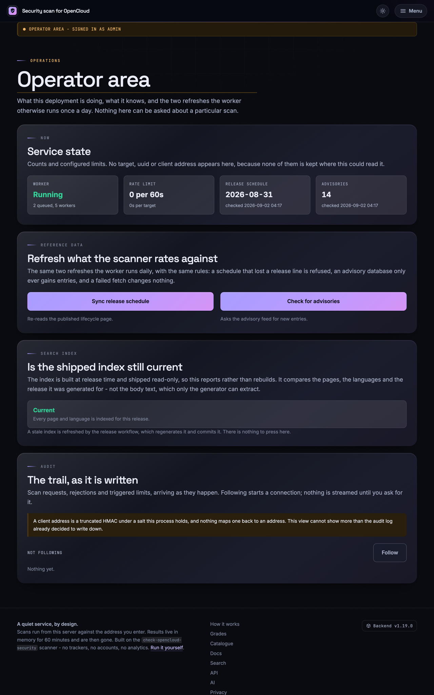
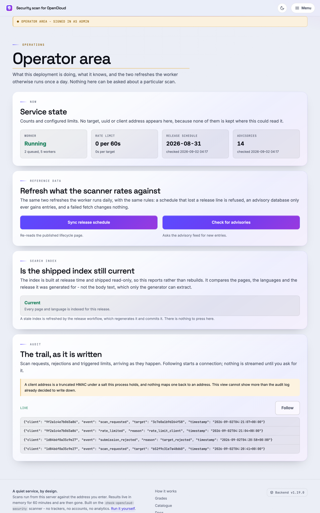

# Operación

Notas internas de operación para administradores que ejecutan o mantienen este repositorio y sus despliegues.

Este documento **no** se publica para nadie que no haya sido autorizado. Queda fuera, a propósito, de todos los manifiestos que muestran algo a un desconocido:

| Artefacto | Por qué este documento queda fuera |
|:--|:--|
| Wheel de PyPI | `[tool.hatch.build.targets.wheel] only-include` solo nombra `check_opencloud_security.py` y `opencloud_local_scan` |
| sdist de PyPI | `[tool.hatch.build.targets.sdist] include` es una lista explícita de archivos |
| `/documentation` | Se genera solo a partir de `DOCUMENTATION_PAGES` en `webapp/documentation.py` |
| Búsqueda del sitio | `webapp/search.py` enumera explícitamente las plantillas públicas |
| Sitemap y `robots.txt` | Se construyen con el mismo manifiesto público; el área de operación no figura en ninguno |

Añadirlo a cualquiera de esas listas lo publicaría: no lo haga.

**El único lugar donde se muestra** es el área de operación, en `/admin/docs/operations` (consulte [El área de operación en /admin](#the-operators-area-at-admin)). No es una excepción a la regla anterior, sino su aplicación: el área autoriza cada solicitud a través del outpost y responde **404** a todos los demás, y lee su propio manifiesto, `OPERATOR_DOCUMENTATION_PAGES`, que no alimenta ninguna de las superficies de la tabla. `tests/test_webapp_admin.py` lo garantiza.

Lo que sí cambia: la página *renderizada* se genera en tiempo de compilación en `frontend/templates/admin-docs/`, de modo que su texto viaja dentro del paquete web y de la imagen del contenedor aunque ninguna solicitud no autorizada pueda alcanzarla. Solo es aceptable porque las fuentes ya son públicas en el repositorio: son notas de operación, no credenciales. **Manténgalo así: nada que no pueda leer un desconocido tiene cabida en este documento.**

Las reglas de *desarrollo* (arquitectura, límites entre capas, política de ADR, proceso de publicación) están en `AGENTS.md`. Para diagnosticar un *análisis* que informa algo extraño, lea `docs/troubleshooting.md`. Este documento cubre lo que queda en medio: mantener los datos actualizados, reconstruir lo generado y saber dónde mirar cuando el servicio falla.

## Contenido {#contents}

- [Los dos archivos de datos de los que depende todo](#the-two-data-files-everything-depends-on)
- [Qué se actualiza solo y cuándo](#what-updates-itself-and-when)
- [Actualizar la base de datos de vulnerabilidades](#updating-the-vulnerability-database)
- [Actualizar el calendario de versiones (nuevas versiones de OpenCloud)](#updating-the-release-schedule-new-opencloud-versions)
- [Actualizar los datos en un host de monitorización](#refreshing-data-on-a-monitoring-host)
- [Regenerar la documentación del frontend](#rebuilding-the-frontend-documentation)
- [Regenerar el índice de búsqueda](#rebuilding-the-search-index)
- [Construir el paquete web](#building-the-web-bundle)
- [Una instancia local para probar el frontend](#a-local-instance-for-testing-the-frontend)
- [El servicio web se actualiza en tiempo de ejecución](#the-web-service-refreshes-itself-at-runtime)
- [El área de operación en /admin](#the-operators-area-at-admin)
- [Dónde mirar cuando algo falla](#where-to-look-when-something-breaks)
- [Cuando OpenCloud mueve su documentación](#when-opencloud-moves-its-documentation)
- [Limitaciones que conviene conocer antes de que alguien pregunte](#limitations-worth-knowing-before-somebody-asks)
- [Lo que un administrador no debe hacer nunca](#things-an-administrator-must-never-do)

## Los dos archivos de datos de los que depende todo {#the-two-data-files-everything-depends-on}

```
opencloud_local_scan/data/vulnerabilities.json   # which versions are affected by what
opencloud_local_scan/data/release_schedule.json  # which release lines are still supported
```

Cada nota que produce este proyecto parte de esos dos archivos. Una base de vulnerabilidades desactualizada no califica una instancia con generosidad: le dice a alguien que una instancia vulnerable está bien. Un calendario desactualizado convierte una instancia sin soporte en una desconocida. Trate ambos como datos relevantes para la seguridad, no como contenido.

La CI los actualiza y los confirma en el repositorio. Una persona revisa la pull request; nada los reescribe en producción.

## Qué se actualiza solo y cuándo {#what-updates-itself-and-when}

| Workflow | Frecuencia (UTC) | Qué hace |
|:--|:--|:--|
| `vulnerability-db.yml` | diario, 05:41 | Vuelve a leer OSV y abre una PR si la base cambió |
| `release-schedule.yml` | lunes, 04:17 | Vuelve a leer la página del ciclo de vida y abre una PR con el JSON y el bloque del README |
| `check-opencloud-links.yml` | martes, 05:41 | Comprueba de nuevo cada enlace documentado de OpenCloud |
| `supply-chain.yml` | lunes, 04:17 | Revisión de dependencias y cadena de suministro |
| `bandit.yml` | miércoles, 17:38 | Análisis estático de seguridad |
| `integration-opencloud-container.yml` | sábados, 03:17 | Analiza un contenedor real de OpenCloud |
| `attest-security-data.yml` | push a `main` que toca alguno de los archivos de datos | Los firma con Sigstore |

Los tres primeros aceptan `workflow_dispatch`, así que la forma normal de forzar una actualización es ejecutar el workflow desde la pestaña Actions en lugar de lanzar el script a mano. Ejecute los scripts en local cuando el propio workflow esté roto, cuando trabaje sin conexión o cuando quiera ver el diff antes de que se convierta en una pull request.

## Actualizar la base de datos de vulnerabilidades {#updating-the-vulnerability-database}

```bash
python scripts/update_vulnerability_db.py             # fetch and write
python scripts/update_vulnerability_db.py --check     # report only, write nothing
```

Opciones útiles:

| Opción | Valor por defecto | Finalidad |
|:--|:--|:--|
| `--url` | `https://api.osv.dev/v1/query` | Apuntar a un espejo o a una fuente interna |
| `--package` | `github.com/opencloud-eu/opencloud` | Consultar otro módulo |
| `--timeout` | `30` | Segundos |
| `--check` | desactivado | Salir con código distinto de cero si el archivo está desactualizado; no escribe nada |
| `--allow-failure` | desactivado | Salir con `0` si la fuente no responde (para ejecuciones programadas) |

**Una actualización solo añade.** Un aviso que la fuente ya no menciona permanece en el archivo, porque una fuente que ha olvidado una vulnerabilidad no la ha corregido. Una entrada solo se elimina a mano, y una edición manual es también la única manera de incorporar algo que OSV no conoce.

Después de ejecutarlo, revise el diff antes de confirmar. Lo esperable son entradas nuevas y rangos enriquecidos. Lo preocupante son entradas que desaparecen, o una entrada que no nombra ningún rango de versiones (coincidiría con todas las versiones publicadas).

## Actualizar el calendario de versiones (nuevas versiones de OpenCloud) {#updating-the-release-schedule-new-opencloud-versions}

Este es el script que necesita cuando OpenCloud publica una versión que el analizador todavía no conoce.

```bash
python scripts/update_release_schedule.py             # fetch, write JSON + README block
python scripts/update_release_schedule.py --check     # report only
python scripts/update_release_schedule.py --no-readme # leave the README block alone
```

| Opción | Valor por defecto | Finalidad |
|:--|:--|:--|
| `--url` | `https://docs.opencloud.eu/docs/admin/resources/lifecycle/` | Página del ciclo de vida o espejo |
| `--timeout` | `30` | Segundos |
| `--check` | desactivado | Salir con código distinto de cero si está desactualizado |
| `--no-readme` | desactivado | Escribir solo el JSON |
| `--allow-failure` | desactivado | Salir con `0` si la página no se puede leer o analizar |

Escribe **ambos**: `opencloud_local_scan/data/release_schedule.json` y el bloque generado de `README.md` entre `<!-- release-schedule:start -->` y `<!-- release-schedule:end -->`.

- No edite nunca ese bloque del README a mano. La siguiente actualización lo sobrescribe y `tests/test_update_script.py` falla si no coincide con el calendario que se distribuye a su lado.
- Eliminar los marcadores es un error, porque de lo contrario el README dejaría de actualizarse sin que nadie lo notara.
- El texto y los ejemplos *alrededor* del bloque están escritos a mano y nombran versiones antiguas a propósito. No los toque.

La página del ciclo de vida es el único lugar donde se indica el *tipo* de versión. La lista de versiones de GitHub no distingue una versión rolling de una de producción, así que si la página no está disponible no hay fuente alternativa: el calendario se queda como está.

**Es normal que una versión más nueva tenga menos soporte que una más antigua.** Rolling, producción y LTS se publican en paralelo. No es un error que haya que corregir.

## Actualizar los datos en un host de monitorización {#refreshing-data-on-a-monitoring-host}

Un plugin instalado lleva los datos que se distribuyeron con su versión. Entre versiones, un host de monitorización puede obtener los datos revisados sin actualizar el paquete:

```bash
check-opencloud-scanner refresh-data
# ~/.cache/check-opencloud-security/release_schedule.json
# ~/.cache/check-opencloud-security/vulnerabilities.json
```

| Opción | Valor por defecto | Finalidad |
|:--|:--|:--|
| `--output-dir` | `~/.cache/check-opencloud-security` | Dónde se guardan los dos archivos JSON |
| `--schedule-url` | *(sin definir)* | Leer en directo la página del ciclo de vida |
| `--advisory-url` | *(sin definir)* | Consultar en directo OSV (o un espejo) |
| `--timeout` | `30` | Segundos |

**Sin URL**, ambos documentos proceden de la rama `main` del propio repositorio del proyecto, es decir, de los archivos que una persona ya revisó e integró, y se verifica una atestación de Sigstore antes de darles crédito (ADR 0027). Esta es la vía recomendada.

**Con una URL explícita**, la fuente se consulta en directo y nada la firma; solo se aplican las comprobaciones estructurales y el comando registra una advertencia. Úsela para un espejo aislado o un fork, no porque parezca más actual.

Las comprobaciones estructurales se aplican en ambos casos: se rechaza un calendario que ha perdido una línea que el archivo incluido conoce, y una base de avisos sin entradas acotadas utilizables.

Conviene entender la cadena que hay detrás de esa firma, porque es en lo que confía un host de monitorización: los workflows de actualización abren una pull request, una persona la integra y `attest-security-data.yml` firma después los archivos integrados en `main` con un certificado Sigstore de corta duración vinculado a la identidad de ese workflow. No existe ninguna clave de firma que pueda filtrarse, y la integración humana es la frontera de revisión que certifica la atestación. `opencloud_local_scan/data_signing.py` fija el emisor, la ruta del workflow y la referencia esperados, y falla de forma cerrada cuando existe una atestación que no coincide.

A continuación, indique los archivos al analizador en el archivo de configuración:

```yaml
scanner:
  release_schedule: /var/lib/check-opencloud-security/release_schedule.json
  vulnerability_db:
    - /var/lib/check-opencloud-security/vulnerabilities.json
```

o mediante variables de entorno: `COS_SCANNER_RELEASE_SCHEDULE`, `COS_SCANNER_VULNERABILITY_DB` (las listas se unen con `;`). La precedencia es **opción de CLI > variable de entorno > archivo > valor por defecto**.

Una entrada de cron sensata actualiza a diario, bastante antes de los análisis que usan los datos, y alerta ante un código de salida distinto de cero en lugar de fallar en silencio.

## Regenerar la documentación del frontend {#rebuilding-the-frontend-documentation}

`/documentation` es un artefacto de **compilación**. En producción se sirven plantillas HTML confirmadas en el repositorio y no hay analizador de Markdown.

```bash
python scripts/build_frontend_documentation.py           # regenerate
python scripts/build_frontend_documentation.py --check   # fail if stale (CI runs this)
```

- Fuentes: `README.md`, `opencloud_local_scan/README.md` y archivos seleccionados de `docs/`, enumerados en el manifiesto `webapp/documentation.py`.
- Salida: `frontend/templates/docs/*.html` y sus subdirectorios por idioma.
- Ejecútelo después de editar cualquier fuente de la lista y confirme el HTML regenerado. La CI rechaza una salida desactualizada.
- No edite nunca el HTML generado a mano. La siguiente compilación lo descarta.

Los cuerpos de las guías públicas se generan a partir de fuentes en inglés, alemán, francés y español (`docs/`, `docs/de/`, `docs/fr/`, `docs/es/`; ADR 0063). Un idioma sin fuentes recibe el cuerpo en inglés con `lang="en"` y la interfaz traducida (ADR 0020). Los documentos de operación traducidos están además en `docs/<idioma>/operator/`; los ADR originales siguen en inglés.

## Regenerar el índice de búsqueda {#rebuilding-the-search-index}

```bash
python scripts/build_search_index.py            # regenerate
python scripts/build_search_index.py --check    # fail if stale
```

Salida:

```
frontend/static/search-index.json      # English: every page and its text
frontend/static/search-index.de.json   # overlays: translated chrome only
frontend/static/search-index.es.json
frontend/static/search-index.fr.json
```

El generador recibe una lista explícita de plantillas públicas en `webapp/search.py`. No tiene almacén, ni API, ni plantilla de resultados, ni exportación, ni UUID ni entrada de red: es estructuralmente imposible indexar resultados de análisis o direcciones enviadas, y así debe seguir. En condiciones normales, solo el workflow de publicación actualiza estos archivos. Los documentos de operación traducidos solo entran en el índice protegido del área de operación.

## Construir el paquete web {#building-the-web-bundle}

La aplicación web nunca se distribuye en PyPI. Se distribuye como tarball:

```bash
python scripts/build_web_bundle.py
# dist/check_opencloud_security_web.tar.gz  (+ .sha256)
```

No forma parte de `pytest`, así que ejecútelo después de modificar `webapp/` o `frontend/`. `tests/test_webapp_packaging.py` construye los artefactos reales y falla si `webapp/` o `frontend/` se cuelan en el wheel o el sdist.

## Una instancia local para probar el frontend {#a-local-instance-for-testing-the-frontend}

Una pila desechable (aplicación web, worker y Redis) construida a partir de su propio árbol de trabajo, para ver el sitio en un navegador antes de publicar nada.

### La versión de un solo comando {#the-one-command-version}

Si solo quiere la pila tal como se distribuye, sin configuración propia:

```bash
cd docker
docker compose up --build
# http://127.0.0.1:8811
```

El `docker/docker-compose.yml` distribuido ya construye desde la raíz del repositorio (`context: ..`), así que no hace falta nada más. Su única limitación para las pruebas es la importante: define `COS_WEB_ALLOW_PRIVATE_TARGETS: "false"`, por lo que la protección SSRF rechaza toda dirección privada, de loopback o de enlace local, que es justo donde vive su instancia de OpenCloud de prueba. Obtiene el sitio, pero no puede completar un análisis contra nada local.

### La versión con el asistente, que es la que necesita {#the-wizard-version-which-is-the-one-you-want}

`docker/setup-wizard.py` escribe una pila configurada para esto. Es independiente, solo usa la biblioteca estándar y no comparte nada con el asistente `--configure` del plugin.

```bash
cd docker
./setup-wizard.py \
    --non-interactive \
    --preset private \
    --image-source build \
    --output-dir ~/scan-test \
    --compose-file docker-compose.local.yml \
    --env-file .env.local
```

Qué hace cada parte y por qué:

| Opción | Por qué importa aquí |
|:--|:--|
| `--preset private` | Define `COS_WEB_ALLOW_PRIVATE_TARGETS=true`, para que se permita analizar una instancia local. También desactiva la indexación y activa el registro de auditoría |
| `--non-interactive` | Acepta todos los valores por defecto y genera las credenciales. Sin ella, pregunta una a una, con una explicación y una respuesta de ejemplo para cada pregunta |
| `--image-source build` | Construye el código de este checkout. Sin ella, la pila descarga la imagen publicada en Docker Hub, que es el valor por defecto y no lo que usted está probando |
| `--output-dir ~/scan-test` | **Escribe fuera del repositorio.** Consulte la advertencia más abajo |
| `--compose-file` / `--env-file` | Cualquier nombre excepto los cuatro distribuidos. El asistente rechaza `docker-compose.yml`, `docker-compose.dockerhub.yml`, `docker-compose.authentik.yml` y `docker-compose.monitoring.yml` salvo con `--force`, porque el siguiente `git pull` se llevaría por delante un despliegue hecho a mano |

La fuente de la imagen es por defecto la publicada en Docker Hub, por eso esta receta pide `build` explícitamente. Para una compilación, el asistente resuelve el contexto a la raíz del repositorio como ruta **absoluta**. Eso permite usar `--output-dir` en cualquier lugar y seguir construyendo el código que tiene delante.

Después:

```bash
cd ~/scan-test
docker compose -f docker-compose.local.yml up -d --build
open http://127.0.0.1:8811
```

> **Escriba los archivos generados fuera del repositorio.** `.env.local` contiene una contraseña de Redis generada, un token de purga, las claves de firma de purga y exportación y la sal de auditoría, y **no** está cubierto por `.gitignore`: el patrón `.env` que contiene coincide con un archivo llamado exactamente `.env`, no con `.env.local`. Si se genera dentro de `docker/` aparece como no rastreado y un `git add` amplio lo incluirá. El asistente lo crea con permisos `0600`, que lo protegen de otros usuarios del host, no de que usted lo confirme.

Dos comportamientos del asistente que, de otro modo, le confundirán:

- **Volver a ejecutarlo edita en lugar de regenerar.** Un archivo de entorno existente se vuelve a leer y sus valores pasan a ser los valores por defecto, de modo que las credenciales sobreviven a una segunda ejecución.
- **En modo no interactivo, una segunda ejecución en el mismo directorio muestra `Nothing written.` y se detiene.** La pregunta de sobrescritura tiene *no* por defecto y una ejecución no interactiva toma ese valor. Use `--force` cuando quiera reemplazar los archivos.

### El ciclo rápido de edición {#the-fast-edit-loop}

Reconstruir la imagen por un retoque de CSS no es el ciclo que busca. Monte el frontend en su lugar: la imagen lo coloca en `/app/frontend`, y tanto el cargador de plantillas como el montaje estático leen del disco:

```yaml
# ~/scan-test/docker-compose.override.yml
services:
  web_app:
    volumes:
      - /path/to/check-opencloud-security/frontend:/app/frontend:ro
```

```bash
docker compose -f docker-compose.local.yml -f docker-compose.override.yml up -d
```

Ahora un cambio en una plantilla, en `app.css` o en cualquier archivo de `frontend/static/js/` se ve en la siguiente carga de página. Lo que sigue necesitando un reinicio:

- cualquier cosa en `webapp/`: el Python está incluido en la imagen y uvicorn se ejecuta sin `--reload`;
- `frontend/static/llms.txt` y `llms-full.txt`, que se leen una sola vez al arrancar;
- `frontend/templates/docs/*.html`, que se regenera con `scripts/build_frontend_documentation.py` en lugar de editarse.

`COS_WEB_FRONTEND_DIR` cumple la misma función si prefiere montarlo en otro lugar e indicárselo a la aplicación.

### Darle algo que analizar {#giving-it-something-to-scan}

Los análisis se ejecutan **desde el contenedor del worker**, así que `localhost` en el formulario se refiere a ese contenedor, no a su máquina. Para llegar a una instancia de OpenCloud que se ejecuta en el host, use `host.docker.internal` (Docker Desktop) o la dirección del host en el bridge de Docker; para llegar a una en otro contenedor, ponga ambas pilas en la misma red de Docker y use el nombre del servicio.

Sin una instancia real puede probar igualmente la mayor parte del frontend: el formulario, la validación, la cola y los estados de progreso, el 404 de un uuid caducado, el catálogo, las páginas de documentación y todas las páginas estáticas. Un análisis que no puede conectar termina como análisis *fallido* y muestra la página de error, que también merece un vistazo.

`tests/fake_opencloud.py` es un servidor HTTP real controlado por una dataclass `InstanceBehaviour`, y permite mostrar una página de *resultados* real con hallazgos sin necesitar un despliegue de OpenCloud.

### Desmontarla {#tearing-it-down}

```bash
cd ~/scan-test
docker compose -f docker-compose.local.yml down -v   # -v also drops the Redis volume
rm docker-compose.local.yml .env.local
```

Los resultados viven en Redis con un TTL y la aplicación no escribe nada en disco, así que `down -v` no deja rastro.

## El servicio web se actualiza en tiempo de ejecución {#the-web-service-refreshes-itself-at-runtime}

El calendario que confirma la CI queda congelado en el momento en que se construye una imagen, así que el worker vuelve a leer ambos documentos una vez al día y los guarda en Redis, donde cada análisis los recoge. No se escribe nada en disco.

| Ajuste | Valor por defecto | Finalidad |
|:--|:--|:--|
| `COS_WEB_SCHEDULE_REFRESH` | activado | Relectura diaria del ciclo de vida |
| `COS_WEB_SCHEDULE_REFRESH_HOUR` | `4` | Hora (UTC) de la lectura diaria. Conviene variarla entre despliegues para que no lleguen todos a la vez |
| `COS_WEB_SCHEDULE_REFRESH_URL` | página del ciclo de vida | Sustituir la fuente |
| `COS_WEB_ADVISORY_REFRESH` | activado | Relectura diaria de avisos |
| `COS_WEB_ADVISORY_REFRESH_URL` | OSV | Sustituir la fuente |
| `COS_WEB_ADVISORY_REPOSITORY_URL` | avisos de OpenCloud en GitHub | Segunda fuente para avisos que OSV nunca recibió; `off` la omite |

Claves de Redis, por si necesita mirar:

```
cos:web:schedule:document     cos:web:schedule:checked     cos:web:schedule:attempt
cos:web:advisories:document   cos:web:advisories:checked   cos:web:advisories:attempt
```

`:checked` solo avanza cuando una lectura se **acepta**, y eso es lo que hace que un valor antiguo merezca atención y también lo que no puede explicar: una fuente inaccesible y un documento que las comprobaciones rechazan con razón dejan ambos una fecha que ya no avanza. `:attempt` es lo que la última ejecución obtuvo de la fuente (`updated`, `unchanged`, `rejected` o `failed`) y se escribe tanto si se guardó algo como si no, de modo que la diferencia es visible sin volver a descargar nada.

Las reglas de aceptación son todo el modelo de seguridad, y son asimétricas a propósito:

- Un calendario candidato solo se acepta si sigue conociendo **todas las líneas que conoce el archivo incluido**. Perder una línea convierte una instancia sin soporte en una desconocida.
- Una actualización solo **añade** avisos. Una fuente que responde con una lista vacía no cambia nada.
- **Nunca se da crédito a nada sin acotar.** Un aviso que no nombra versiones coincide con todas las versiones publicadas, y las fuentes públicas publican esa forma.
- Un número absurdo de avisos se rechaza entero.
- Cualquier fallo deja la base exactamente como estaba.
- Tras un nuevo despliegue, prevalece un archivo incluido más reciente.

Así que la respuesta correcta a «la actualización fue rechazada» es examinar lo que publicó la fuente, no relajar la regla.

## El área de operación en /admin {#the-operators-area-at-admin}

Opcional y desactivada por defecto. Lea esta sección antes de activarla.

```bash
COS_WEB_ADMIN_ENABLED=true
COS_WEB_ADMIN_PROXY_SECRET=<32+ characters, generated>
COS_WEB_ADMIN_USERS=okko;sam
```

El asistente pregunta los tres valores (`docker/setup-wizard.py`, sección del área de operación) y genera el secreto en `.env`.

**Un operador es un nombre de usuario en dos lugares**: en `COS_WEB_ADMIN_USERS` y en el grupo `opencloud-scanner-operators` de Authentik, al que está vinculada la aplicación `/admin`. El enlace de inscripción del asistente hace ambas cosas; crear la cuenta y añadirla al grupo a mano, entrar en `akadmin` con una clave de recuperación y el segundo factor que exige cada inicio de sesión se explican en [`docs/authentik.md`](../../../docs/authentik.md#an-operator-for-admin).

**Desactivada significa que el área no existe.** Sin `COS_WEB_ADMIN_ENABLED`, las rutas nunca se registran y `/admin` responde el mismo 404 que cualquier otra ruta desconocida, de modo que un despliegue que no usa el área no revela que existe.

**El servicio no autentica a nadie.** Un proveedor proxy de Authentik inicia la sesión del operador y reenvía la identidad como cabeceras; el servicio solo confía en ellas porque el proxy también envía `COS_WEB_ADMIN_PROXY_SECRET` como `X-COS-Admin-Proxy`. Dos consecuencias que conviene interiorizar:

- **Acceder directamente al contenedor no le da nada.** Otro contenedor en la misma red de Docker, o un puerto publicado por accidente, recibe 404 sin esa cabecera.
- **Si coloca su propio proxy inverso delante en lugar del Authentik incluido, debe añadir esa cabecera usted mismo.** Si no, el área queda inaccesible, que es el modo de fallo deseado, aunque parecerá un error. `authentik/blueprints/opencloud-admin.yaml` aprovisiona el proveedor, el grupo de operadores y el outpost para la pila incluida.

**El asistente escribe la configuración del proxy que hace esto.** Active el área, pídale el Authentik incluido y su pregunta sobre el proxy inverso produce un archivo funcional de nginx, Caddy o Traefik: cada solicitud a `/admin` pasa primero por el outpost, y solo lo que el outpost acepta se reenvía, con las cabeceras de identidad y `X-COS-Admin-Proxy`. El secreto no se escribe en ese archivo: nginx recibe un `include` de una línea hacia un fragmento legible solo por su propietario, y Caddy y Traefik lo leen de su propio entorno. Apache es la excepción: no tiene autenticación delegada propia, así que el archivo generado enruta todo *excepto* el área y explica por qué. Consulte [`docker/README.md`](../../../docker/README.md#the-reverse-proxy).

**Un despliegue que no puede imponer el inicio de sesión se niega a arrancar.** Sin secreto, con un secreto de menos de 32 caracteres o con `COS_WEB_ADMIN_USERS` vacío, falla al arrancar en lugar de servir una consola abierta. Una lista de usuarios vacía nunca se interpreta como «cualquiera autenticado por Authentik».

**Cerrar la sesión también es tarea del proveedor.** El servicio no tiene sesión que terminar, así que el enlace *Cerrar sesión* de la banda solo aparece cuando indica dónde está la salida:

```bash
COS_WEB_ADMIN_SIGN_OUT_URL=/outpost.goauthentik.io/sign_out
```

Esa ruta es la respuesta de la pila incluida: el mismo proxy inverso que enruta `/outpost.goauthentik.io/` para la autenticación delegada la sirve, así que un despliegue donde el inicio de sesión funciona la tiene. El asistente la escribe por usted cuando el Authentik incluido forma parte de la pila; con su propio proveedor, indique su salida. Si la deja sin definir, la banda nombra al operador y no ofrece salida, lo que es mejor que un control que aparenta cerrar la sesión y no lo hace. Solo se acepta una ruta local o una URL `http(s)`: el valor se inserta en un `href` de una página cuya política de contenido existe para mantener fuera los scripts, así que cualquier otro valor impide el arranque.

Lo que hace el área:

| Tarjeta | Qué hace |
|:--|:--|
| Estado del servicio | Actividad del worker, profundidad de la cola, los límites configurados y cuánto hace que se leyó cada documento de referencia, en forma relativa (`checked 6h ago`), con la marca exacta en el elemento, el acento de advertencia pasados dos ciclos diarios y el nombre del fallo que lo está impidiendo. La casilla del worker tiene tres respuestas, no dos: el latido que lee es una clave de Redis, así que **No se puede saber** significa que el almacén no respondió y no se averiguó nada del worker en ningún sentido |
| Qué ofrece este despliegue | `/mcp` y si exige un token, `/docs`, la indexación, los destinos de red privada, el cifrado en reposo y qué guarda el registro de auditoría y dónde. Son ajustes y no lecturas, así que la tarjeta se genera una vez y nunca se consulta de nuevo: un valor que cambió lo hizo en un proceso con el que la página abierta ya no habla |
| Exclusiones | Las direcciones que este servicio no analizará. La **única tarjeta que escribe**: una entrada añadida aquí rechaza el siguiente envío en todos los procesos sin reinicio, y un análisis que ya espera en la cola se rechaza en lugar de ejecutarse. Las entradas de `COS_WEB_BLOCKED_TARGETS` se muestran y no se pueden retirar aquí |
| Datos de referencia | Ejecuta los mismos `refresh_schedule` / `refresh_advisories` diarios que el worker, con las mismas comprobaciones, tras una pausa de 60 segundos por acción |
| Índice de búsqueda | **Informa** de si el índice distribuido sigue coincidiendo con esta compilación. Nunca lo reconstruye: eso lo hacen cada pull request a main y el workflow de publicación. Si está desactualizado, la tarjeta enumera cada motivo y muestra cómo corregirlo. Tres veredictos, no dos: un índice que no nombra la versión para la que se construyó es **No se puede saber**, porque se pudieron comparar sus páginas e idiomas, pero no su texto |
| Auditoría | Transmite los registros de auditoría a medida que se escriben, desde el archivo de registro si hay uno configurado y, si no, desde un anillo acotado en memoria |

Junto a la vista general hay seis lugares más, accesibles desde la barra de pestañas en la parte superior de cada página del área:

| Pestaña | Qué muestra |
|:--|:--|
| Configuración | Cada variable `COS_WEB_*` que lee el servicio web, agrupada, con el valor **vigente** (tras el análisis, los límites y los valores de reserva, de modo que un valor mal formado muestra el valor por defecto al que recurrió), si lo definió el entorno o se aplica el valor por defecto, y el valor por defecto y la descripción documentados en la tabla de `docs/webapp.md`. Un token, una clave, una sal o la contraseña de Redis solo aparecen como **definido** o **no definido**. Los nombres `COS_WEB_*` que el servicio no lee se enumeran por nombre, sin sus valores, porque una variable mal escrita deja en vigor el valor por defecto sin que nada lo indique. Es el entorno de este proceso web: no el de OpenCloud ni el del worker, que lee las mismas variables en su propio contenedor |
| Reglas | Cómo se decide una nota y cada regla que se aplica a una solicitud, con los valores de este despliegue: la escala de notas y los techos de gravedad del analizador, las sustituciones por fin de soporte y por canal, si cuentan las comprobaciones adicionales, cuántas excepciones puede elegir un visitante y los datos de referencia utilizados; después los límites por cliente, diarios y por destino, el bloqueo por sondeo con sus avisos y su escalado (1 h → 6 h → 24 h por defecto), los rangos, nombres y servicios DNS comodín que rechaza la protección SSRF, el modo de aprobación, las opciones con las que se construye cada análisis y los límites de credenciales y del botón de actualización. Cada regla indica **Aplicada** o **Desactivada** y nombra las variables `COS_WEB_*` de las que depende. Cada número y lista se lee de los ajustes en ejecución y de las constantes que usa el código que los aplica (`webapp/rules.py`), así que la pestaña no puede describir un límite que el servicio ya no tiene; `tests/test_webapp_admin_rules.py` cambia ajustes y busca el cambio en la página |
| Arquitectura | `ARCHITECTURE.md`: cómo se organiza el repositorio y por qué sus límites están donde están |
| Operación | Este documento: los datos que hay que mantener al día, qué reconstruir y dónde mirar cuando algo falla |
| Versiones | Las diez secciones publicadas más recientes de `CHANGELOG.md`, de la más nueva a la más antigua: lo que cambiaron esta versión y las anteriores. `[Unreleased]` queda fuera: es lo que un despliegue todavía no ejecuta |
| Decisiones | Cada registro de decisión de arquitectura que indexa `adr/README.md`, con su estado y un filtro por número, título y estado; cada registro se abre como página propia en `/admin/decisions/<slug>`. Un enlace de un registro, o de `ARCHITECTURE.md`, a otro se queda dentro del área en lugar de ir a GitHub. La búsqueda del área indexa el texto completo de cada registro |

Los tres documentos se generan en `frontend/templates/admin-docs/` en tiempo de compilación mediante `scripts/build_frontend_documentation.py`, a partir de `OPERATOR_DOCUMENTATION_PAGES` en lugar del manifiesto público, de modo que no se analiza Markdown en tiempo de ejecución y ningún documento llega a `/documentation`, al sitemap ni al índice de búsqueda público. Arquitectura y Operación se generan además en alemán, español y francés a partir de `docs/<idioma>/operator/`, conservando los anclajes de sección y los comandos en inglés; la línea sobre cada página nombra el archivo inglés del que procede. El texto de las notas de versión sigue en inglés en todos los idiomas (ADR 0078). Las descripciones de la pestaña de configuración proceden del mismo script, que extrae la tabla de `docs/webapp.md` a `webapp/environment_reference.py`; su `--check` en la CI falla cuando ambos difieren, y `tests/test_webapp_admin_configuration.py` falla cuando una variable se lee, se enumera o se documenta en un lugar y no en los demás.

Los registros de decisión siguen el mismo camino hasta `frontend/templates/admin-decisions/`, a partir de la tabla índice de `adr/README.md` y no del listado del directorio, así que un registro llega al área cuando llega al índice. Como el paquete web no incluye `adr/`, el mismo script escribe la lista de registros en `webapp/decision_records.py`, que leen las rutas y el índice de búsqueda del área. **El texto de los ADR sigue en inglés** (ADR 0077); la interfaz que los rodea sigue el idioma del lector. Después de añadir o editar un registro, ejecute `scripts/build_frontend_documentation.py` y `scripts/build_search_index.py`; el `--check` de ambos en la CI falla hasta que lo haga.

La pestaña Versiones solo cambia cuando se publica una versión: el workflow de publicación renombra `[Unreleased]` con la nueva versión y, en el mismo commit, regenera esa página y el índice de búsqueda del área. La entrada del changelog de una pull request normal no la toca, así que nunca hay que reconstruirla a mano.

Lo que deliberadamente no puede hacer: nombrar un destino, un uuid, un resultado o la dirección de un cliente. Las estadísticas son recuentos y ajustes, y la vista de auditoría muestra los registros seudonimizados que el log ya escribió: una huella es un HMAC truncado con una sal que conserva el proceso, y nada permite revertirla. La tarjeta de exclusiones es el único lugar donde aparecen direcciones, y son la configuración propia del operador, no tráfico de nadie; `/admin/state`, el documento que se copia en un informe de incidencia, solo indica cuántas hay.

**Sobre el único control que escribe.** Añadir una exclusión es lo único del área que cambia lo que hace el servicio, y está diseñada para ser lo más segura posible:

- solo puede **rechazar** un análisis. Nada aquí hace que el servicio analice algo, alcance un destino o amplíe un límite, así que lo peor que consigue una sesión de operador robada es un despliegue que analiza menos de lo que podría;
- `COS_WEB_BLOCKED_TARGETS` es un **mínimo**. Esas entradas aparecen en la lista sin control al lado, e intentar retirar una se rechaza con una indicación hacia el entorno en lugar de no hacer nada, de modo que su archivo compose sigue siendo la verdad sobre lo que declara;
- **las entradas añadidas aquí viven en Redis**, así que son exactamente tan duraderas como su Redis. Lo que deba sobrevivir a un vaciado pertenece a `COS_WEB_BLOCKED_TARGETS`; la tarjeta lo indica bajo la lista;
- **una entrada tiene como máximo 253 caracteres**, la longitud máxima de un nombre de host, tanto en esta tarjeta como en `COS_WEB_BLOCKED_TARGETS`. Nada más largo podría coincidir con un destino que el servicio aceptara, así que se rechaza en lugar de guardarse como una exclusión que no excluye nada;
- **las dos mitades se comparan analizadas, no como texto.** `Example.COM` en su archivo compose y `example.com` escrito aquí son una sola exclusión, no dos: la tarjeta no guarda lo que el entorno ya contiene y se niega a retirarlo se escriba como se escriba;
- **un almacén que no se puede leer rechaza el análisis** en lugar de continuar sin la lista, porque una exclusión perdida es el fallo que analiza a alguien que pidió no ser analizado. El visitante recibe un `503` y una frase en su idioma; el registro de auditoría recibe `exclusions_unreadable`, que merece buscarse: significa que este despliegue no pudo alcanzar su propio Redis.

Consulte [ADR 0044](../../../adr/0044-the-operator-area-may-write-the-exclusions.md) para saber por qué el área puede escribir esto y nada más.

**Las lecturas indican su antigüedad.** Se consultan cada diez segundos, y una consulta que deja de responder sería indistinguible de un servicio sin actividad: los números simplemente dejan de moverse. Por eso la página marca la antigüedad de la última respuesta, la incrementa entre consultas y dice claramente cuando lo que está viendo es la última lectura que dio el servicio y no la actual. Una casilla se ilumina cuando cambia su valor. La página deja de consultar mientras su pestaña está en segundo plano y vuelve a leer en cuanto regresa a ella.

**Dos combinaciones de la tarjeta de exposición llevan el acento de advertencia, y solo dos.** Ningún ajuste es un error por sí mismo, por eso se marcan en lugar de rechazarse: servir `/mcp` sin token es para lo que existe un analizador público, y un despliegue que vigila su propia infraestructura tiene que analizar direcciones privadas. Lo que merece una segunda mirada es *la pareja*: `COS_WEB_ALLOW_PRIVATE_TARGETS` en un despliegue que además pide ser indexado es un analizador que los desconocidos pueden encontrar, apuntando a la red en la que se encuentra. En ese caso, casi con seguridad el ajuste que se quería era `COS_WEB_ALLOW_INDEXING=false`.

**Una actualización que ha dejado de llegar se notifica, junto con el tipo de fallo.** Las dos casillas de referencia muestran la antigüedad de sus lecturas igual que la tarjeta superior: `checked 6h ago` en lugar de una marca que restar a la fecha de hoy, el momento exacto en el elemento para quien lo quiera y el acento pasados dos ciclos diarios. Si la última ejecución no tuvo éxito, la nota lo nombra (*no se pudo descargar* o *rechazado por las comprobaciones*), de modo que la distinción `*_failed` / `*_rejected` está en la página antes de que nadie pulse nada. Un despliegue que desactivó la actualización no se considera atrasado; no tiene nada para lo que llegar tarde.

**Probar las fuentes** es la ejecución de prueba junto a esos dos botones: realiza la misma descarga y las mismas comprobaciones y después descarta el resultado, de modo que puede distinguir un `failed` (inaccesible, o la página cambió de forma) de un `rejected` (se leyó bien y las comprobaciones lo rechazaron) sin aplicar nada. Contacta con la fuente, así que está limitado por `COS_WEB_ADMIN_REFRESH_COOLDOWN`, con su propia clave, para que esté disponible justo después de que falle una actualización. A su lado, *Leer de nuevo*, *Copiar diagnóstico* (el documento `/admin/state` en el portapapeles, para un informe de incidencia) y *Vaciar* de la lista de auditoría no cambian nada en ningún sitio.

Dos notas sobre la tarjeta de auditoría. El servicio cierra la transmisión a los 30 minutos y lo indica, en lugar de quedarse en silencio: pulse *Ver en directo* para abrir otra. Y **sin `COS_WEB_AUDIT_LOG_FILE`, la ventana es un anillo en la memoria de un solo proceso**, así que detrás de más de una réplica está viendo los registros de la réplica que respondió; la tarjeta lo indica cuando es el caso. Configure el archivo si necesita el rastro completo.





El área nunca se anuncia: `noindex, nofollow, noarchive`, y está ausente del sitemap, de `llms.txt`, de `/openapi.json`, del manifiesto de documentación y del índice de búsqueda. Tampoco figura en `robots.txt`, a propósito, porque una línea `Disallow` es un archivo público que nombra la ruta.

## Dónde mirar cuando algo falla {#where-to-look-when-something-breaks}

### Primera parada: `/healthz` {#first-stop-healthz}

```bash
curl -s https://your-deployment.example.com/healthz | jq
```

Devuelve `status`, `version`, `queueDepth`, `worker`, además de `releaseSchedule` y `advisories`: fechas, nunca un destino, lo suficiente para ver si la actualización diaria se está produciendo. Responde **503** cuando Redis no está disponible o el worker no está vivo. Un 503 aquí casi siempre significa que el worker ARQ murió o perdió Redis, no que el proceso web esté roto.

### Nombres de logger {#logger-names}

Cada componente registra con su propio nombre, así que puede subir o bajar el nivel de uno sin ahogarse en el resto:

```
check_opencloud.web            check_opencloud.web.worker
check_opencloud.web.schedule   check_opencloud.web.advisories
check_opencloud.web.reference  check_opencloud.web.queue
check_opencloud.web.mcp        check_opencloud.web.mcp.auth
check_opencloud.web.runner     check_opencloud.web.audit
check_opencloud.data_signing   check_opencloud.refresh_data
```

### Los marcadores que buscar {#the-markers-to-grep-for}

Ciclo de vida del análisis (cada uno seguido de un uuid y nada más):

```
scan_created  scan_started  scan_completed
scan_failed   scan_timeout  scan_rejected   scan_expired
```

Datos de referencia:

```
schedule_refresh_updated    schedule_refresh_unchanged
schedule_refresh_failed     schedule_refresh_rejected
schedule_refresh_error      schedule_stored_superseded
advisory_refresh_updated    advisory_refresh_unchanged
advisory_refresh_failed     advisory_refresh_rejected
advisory_refresh_error      advisory_stored_rejected
reference_read_failed
```

`*_rejected` significa que la descarga funcionó y las comprobaciones rechazaron el contenido: ese es el interesante. `*_failed` es un problema de red o de análisis.

Acceso y autorización:

```
purge_throttled   purge_denied      api_docs_enabled
submission_cross_site               language_cross_site
mcp_auth_configured_but_endpoint_disabled
mcp_token_rejected reason=…         (DEBUG level)
forwarded_for_ignored reason=…      (DEBUG level)
```

### Lo que los logs no contienen a propósito {#what-the-logs-deliberately-do-not-contain}

**Ni URL de destino, ni direcciones de cliente, ni resultados.** Un log de lo que todo el mundo analizó es una base de datos de lo que todo el mundo analizó. Es una regla de diseño, no un descuido, lo que significa que *no puede* responder desde los logs a «¿a qué instancia apuntaba ese análisis fallido?», y se supone que no debe poder. Depure con el uuid que le dé quien informa, dentro del TTL del resultado.

El registro de auditoría opcional (`COS_WEB_AUDIT_LOG*`, con sal mediante `COS_WEB_AUDIT_SALT`) es la excepción deliberada y configurable. Lea `docs/webapp.md` antes de activarlo.

### Formas habituales de fallo {#common-shapes-of-failure}

| Síntoma | Dónde mirar primero |
|:--|:--|
| `/healthz` 503 | El contenedor del worker y después la conectividad con Redis (`COS_WEB_REDIS_URL`). El área de operación separa ambos casos: **No responde** en la casilla del worker es el almacén confirmando que el worker no ha escrito ningún latido; **No se puede saber** es el propio almacén inaccesible, lo que no dice nada de ninguno de los dos |
| Envíos aceptados, nada termina | `check_opencloud.web.worker`; profundidad de la cola en `/healthz` |
| Todo da 404 con un enlace de análisis aparentemente válido | TTL del resultado caducado (`COS_WEB_RESULT_TTL`); desconocido, no válido y caducado responden 404 por diseño |
| Las notas parecen generosas | Actualización de avisos rechazada o desactualizada: compruebe `advisories` en `/healthz` |
| Una instancia se califica como desconocida en lugar de sin soporte | Actualización del calendario rechazada o desactualizada |
| Los agentes pueden llegar a `/mcp` sin autenticarse | Deben estar definidos `COS_WEB_MCP_AUTH_ENABLED` y un emisor; un despliegue que pidió un inicio de sesión que no puede imponer se niega a arrancar |
| Los límites de tasa afectan a usuarios legítimos | `COS_WEB_IP_RATE_LIMIT` / `COS_WEB_IP_RATE_WINDOW` / `COS_WEB_TARGET_COOLDOWN`; un 429 de una hora o más es el bloqueo por sondeo (`COS_WEB_PROBE_*`, `rate_limit_probe` en la auditoría, contado en la casilla **Protección contra abusos**) o el límite diario (`COS_WEB_DAILY_SCAN_LIMIT`, `rate_limit_daily`); un 403 es el modo de aprobación (`COS_WEB_REQUIRE_APPROVAL`); detrás de un proxy, también `COS_WEB_TRUST_FORWARDED_FOR` y `COS_WEB_TRUSTED_PROXY_HOPS` |
| Se rechazan análisis de hosts internos | Es la protección SSRF. `COS_WEB_ALLOW_PRIVATE_TARGETS` existe, pero piénselo bien antes de activarlo en un despliegue público |

Para el plugin, y no para el servicio, `docs/troubleshooting.md` cubre los estados `UNKNOWN`, los errores de certificado, las versiones que parecen incorrectas, los códigos de salida y el límite de tasa de GitHub en la comprobación de actualizaciones.

## Cuando OpenCloud mueve su documentación {#when-opencloud-moves-its-documentation}

Casi todo lo que este proyecto sabe de OpenCloud está anclado en enlaces que no controlamos: la página del ciclo de vida de la que se genera el calendario, los avisos, los archivos fuente que demuestran que una opción de endurecimiento está fijada en el código, las guías de instalación. Cuando OpenCloud se reorganiza, esos enlaces se rompen sin que nadie lo note, y un hallazgo explicado con un enlace roto deja al lector sin la corrección.

```bash
python scripts/check_documentation_links.py              # check and fail
python scripts/check_documentation_links.py --warn-only  # report only
python scripts/check_documentation_links.py --list       # no network at all
python scripts/check_documentation_links.py --strict     # treat a redirect as out of date
```

Lo alimentan dos fuentes: cada archivo de texto del repositorio y el propio catálogo de endurecimiento, importado y no buscado con grep. Una referencia partida en dos literales de cadena es invisible para una expresión regular, y son precisamente las URL largas y profundamente anidadas las que más probabilidades tienen de moverse.

**Un código de estado no basta para `docs.opencloud.eu`.** Es una aplicación de una sola página: responde a una dirección inexistente con HTTP 200 y el armazón de la aplicación, y después muestra «Page not found» en el navegador. Todos los enlaces rotos a la documentación que ha tenido este proyecto parecían perfectamente sanos para una comprobación de estado. Por eso los enlaces a ese sitio se comprueban también contra su propio `sitemap.xml`: una dirección `/docs/` que el sitio no enumera está rota, responda lo que responda.

Cuando la comprobación informa de un enlace roto:

1. Busque la nueva dirección de la página en el sitio de documentación de OpenCloud.
2. Actualícela donde esté: normalmente `opencloud_local_scan/hardening.py` para la referencia de un hallazgo, o un archivo Markdown para el texto.
3. Si lo que se movió es *la propia página del ciclo de vida*, el caso es más grave: `LIFECYCLE_DOCUMENTATION_URL` en `opencloud_local_scan/versions.py` es la única definición, y `opencloud_local_scan/schedule_source.py` es el único analizador. Si la página se reestructuró en lugar de solo moverse, puede que el analizador necesite cambios; hasta entonces, el calendario simplemente deja de actualizarse y se conservan los últimos datos válidos.
4. Regenere `/documentation` si editó una fuente que publica.

## Limitaciones que conviene conocer antes de que alguien pregunte {#limitations-worth-knowing-before-somebody-asks}

- **Una buena nota no es un certificado.** El análisis lee lo que una instancia accesible públicamente muestra a un visitante anónimo. Todo lo que hay tras el inicio de sesión, el host, la red, las copias de seguridad y las cuentas queda fuera de lo que puede ver cualquier análisis sin autenticar.
- **El registro de auditoría no se puede comprobar en absoluto.** El servicio de auditoría de OpenCloud no publica ningún endpoint. Un informe limpio no dice nada sobre si está activado.
- **Nunca se usan credenciales**, con una excepción documentada: las contraseñas de las cuentas de demostración que publica OpenCloud, enviadas tal cual al propio proveedor de identidad de la instancia, porque es la única forma de ver desde fuera si esas cuentas siguen existiendo.
- **Algunos hallazgos no se pueden corregir nunca.** Varias opciones que OpenCloud fija en el código no son ajustes: `publicLinkExpirationEnforced` falla en todas las instancias existentes. Esas se marcan como no accionables y quedan fuera de la línea de alerta.
- **Algunos hallazgos se informan pero nunca generan alertas.** Las cabeceras de aviso (`Permissions-Policy`, la familia `Cross-Origin-*`) evalúan cabeceras que *ninguna* instancia de OpenCloud envía, así que su ausencia es un hecho sobre OpenCloud y no sobre este despliegue.
- **El fin de soporte prevalece sobre todo**, incluida una excepción. Una línea de versiones que no recibe correcciones de seguridad es una `F` por limpio que esté el resto.
- **Los resultados son efímeros.** Viven en memoria durante `COS_WEB_RESULT_TTL` y después desaparecen. No hay endpoint de listado, ni historial, ni cuentas. Nadie puede recuperar un resultado caducado, tampoco usted.
- **El uuid es toda la autorización.** Cualquiera que tenga un enlace de resultado puede leer ese informe hasta que caduque. Por eso el panel de compartir advierte antes de publicarlo en un canal.
- **Los datos incluidos envejecen entre versiones.** Un host de monitorización que nunca ejecuta `refresh-data` y nunca se actualiza califica con la base de datos que se distribuyó con su versión.
- **El plugin no llama a casa.** Nunca pide un veredicto a un servicio remoto y, a propósito, no descarga la página del ciclo de vida en cada ejecución: una comprobación que se ejecuta cada pocos minutos no debe convertirse en una descarga de documentación.

## Lo que un administrador no debe hacer nunca {#things-an-administrator-must-never-do}

- **No suba nunca la versión en `pyproject.toml`.** Es el único lugar donde se escribe el número, y un cambio que llega a `main` se publica en PyPI de inmediato. Es decisión del mantenedor.
- **No publique nunca un aviso de seguridad.** Los registros de `security/advisories/` permanecen en `draft`; publicarlos genera alertas de Dependabot para cada instalación afectada y no se puede deshacer.
- **No edite nunca a mano la salida generada**: el bloque del calendario de versiones del README, `frontend/templates/docs/*.html` o los archivos del índice de búsqueda.
- **No añada nunca al servicio web un ajuste del lado de la solicitud para la concurrencia, los tiempos de espera o la política TLS.** Una solicitud elige *qué* analizar, nunca *con qué intensidad*; cualquier otra cosa convierte un servicio público en un amplificador.
- **No conecte nunca nada de aquí con las plataformas de terceros que excluyen las reglas del proyecto**: ni fuentes, ni analítica, ni CDN, ni inicio de sesión, ni metadatos de tarjetas. Las pruebas lo imponen y la CSP no admite ningún origen ajeno.

## Lecturas adicionales {#further-reading}

| Documento | Qué cubre |
|:--|:--|
| `AGENTS.md` | El conjunto de reglas de desarrollo de referencia |
| `docs/webapp.md` | Cada ajuste `COS_WEB_*`, el recorrido de una solicitud y el modelo de aislamiento |
| `docs/troubleshooting.md` | Problemas de análisis del lado del plugin y códigos de salida |
| `docs/redis.md` | Despliegue y persistencia de Redis |
| `docs/secure-deployment.md` | Ejecutar OpenCloud de forma segura: la parte que un análisis no puede ver |
| `docs/authentik.md` | Poner un inicio de sesión delante de `/mcp` |
| `adr/` | Por qué las reglas anteriores son las reglas |
