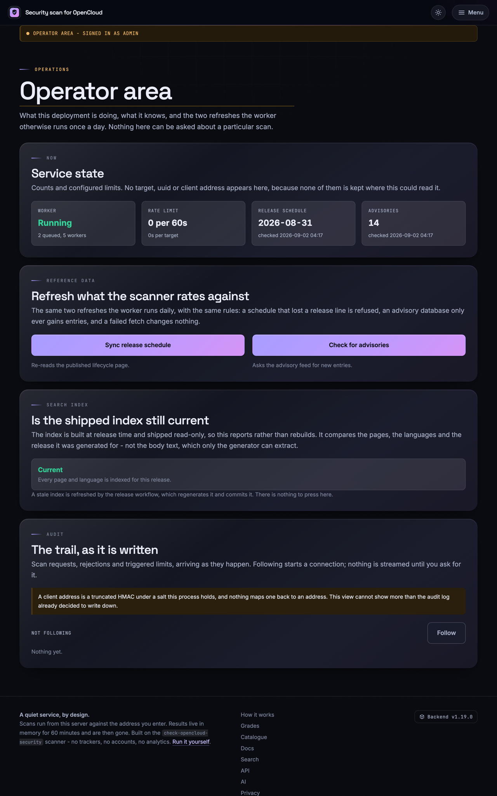
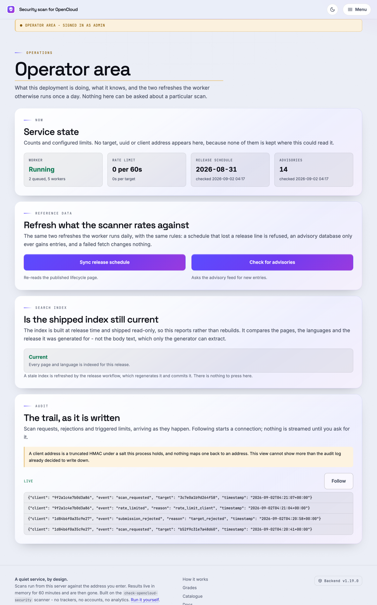

# Exploitation

Notes internes d’exploitation pour les administrateurs qui exploitent ou maintiennent ce dépôt et ses déploiements.

Ce document n’est **pas** publié à qui n’a pas été autorisé. Il est volontairement absent de tous les manifestes qui présentent quelque chose à un inconnu :

| Artefact | Pourquoi ce document en est absent |
|:--|:--|
| Wheel PyPI | `[tool.hatch.build.targets.wheel] only-include` ne nomme que `check_opencloud_security.py` et `opencloud_local_scan` |
| sdist PyPI | `[tool.hatch.build.targets.sdist] include` est une liste explicite de fichiers |
| `/documentation` | Généré uniquement à partir de `DOCUMENTATION_PAGES` dans `webapp/documentation.py` |
| Recherche du site | `webapp/search.py` énumère explicitement les modèles publics |
| Sitemap et `robots.txt` | Construits à partir du même manifeste public ; l’espace d’exploitation n’y figure pas |

L’ajouter à l’une de ces listes le publierait : ne le faites pas.

**Le seul endroit où il est affiché** est l’espace d’exploitation, à `/admin/docs/operations` (voir [L’espace d’exploitation sous /admin](#the-operators-area-at-admin)). Ce n’est pas une exception à la règle ci-dessus, mais son application : l’espace autorise chaque requête via l’outpost et répond **404** à tous les autres, et il lit son propre manifeste, `OPERATOR_DOCUMENTATION_PAGES`, qui n’alimente aucune des surfaces du tableau. `tests/test_webapp_admin.py` le garantit.

Ce qui change en revanche : la page *affichée* est générée à la compilation dans `frontend/templates/admin-docs/`, si bien que son texte voyage dans le paquet web et l’image du conteneur, même si aucune requête non autorisée ne peut l’atteindre. Ce n’est acceptable que parce que les sources sont déjà publiques dans le dépôt : ce sont des notes d’exploitation, pas des identifiants. **Gardez-le ainsi : rien qui ne supporterait pas d’être lu par un inconnu n’a sa place dans ce document.**

Les règles de *développement* (architecture, frontières entre couches, politique des ADR, processus de publication) se trouvent dans `AGENTS.md`. Pour diagnostiquer une *analyse* qui signale quelque chose d’étrange, lisez `docs/troubleshooting.md`. Ce document couvre l’entre-deux : garder les données à jour, régénérer ce qui est généré et savoir où regarder quand le service se comporte mal.

## Sommaire {#contents}

- [Les deux fichiers de données dont tout dépend](#the-two-data-files-everything-depends-on)
- [Ce qui se met à jour seul, et quand](#what-updates-itself-and-when)
- [Mettre à jour la base de vulnérabilités](#updating-the-vulnerability-database)
- [Mettre à jour le calendrier des versions (nouvelles versions d’OpenCloud)](#updating-the-release-schedule-new-opencloud-versions)
- [Actualiser les données sur un hôte de supervision](#refreshing-data-on-a-monitoring-host)
- [Régénérer la documentation du frontend](#rebuilding-the-frontend-documentation)
- [Régénérer l’index de recherche](#rebuilding-the-search-index)
- [Construire le paquet web](#building-the-web-bundle)
- [Une instance locale pour tester le frontend](#a-local-instance-for-testing-the-frontend)
- [Le service web s’actualise à l’exécution](#the-web-service-refreshes-itself-at-runtime)
- [L’espace d’exploitation sous /admin](#the-operators-area-at-admin)
- [Où regarder quand quelque chose casse](#where-to-look-when-something-breaks)
- [Quand OpenCloud déplace sa documentation](#when-opencloud-moves-its-documentation)
- [Limites à connaître avant qu’on vous pose la question](#limitations-worth-knowing-before-somebody-asks)
- [Ce qu’un administrateur ne doit jamais faire](#things-an-administrator-must-never-do)

## Les deux fichiers de données dont tout dépend {#the-two-data-files-everything-depends-on}

```
opencloud_local_scan/data/vulnerabilities.json   # which versions are affected by what
opencloud_local_scan/data/release_schedule.json  # which release lines are still supported
```

Chaque note produite par ce projet part de ces deux fichiers. Une base de vulnérabilités périmée ne note pas une instance avec indulgence : elle affirme qu’une instance vulnérable va bien. Un calendrier périmé transforme une instance en fin de vie en instance inconnue. Traitez les deux comme des données de sécurité, pas comme du contenu.

La CI les actualise et les valide dans le dépôt. Une personne relit la pull request ; rien ne les réécrit en production.

## Ce qui se met à jour seul, et quand {#what-updates-itself-and-when}

| Workflow | Fréquence (UTC) | Ce qu’il fait |
|:--|:--|:--|
| `vulnerability-db.yml` | quotidien, 05:41 | Relit OSV et ouvre une PR si la base a changé |
| `release-schedule.yml` | lundi, 04:17 | Relit la page du cycle de vie et ouvre une PR avec le JSON et le bloc du README |
| `check-opencloud-links.yml` | mardi, 05:41 | Revérifie chaque lien OpenCloud documenté |
| `supply-chain.yml` | lundi, 04:17 | Revue des dépendances et de la chaîne d’approvisionnement |
| `bandit.yml` | mercredi, 17:38 | Analyse statique de sécurité |
| `integration-opencloud-container.yml` | samedi, 03:17 | Analyse un vrai conteneur OpenCloud |
| `attest-security-data.yml` | push sur `main` touchant l’un des fichiers de données | Les signe avec Sigstore |

Les trois premiers acceptent `workflow_dispatch` : la manière normale de forcer une actualisation est donc de lancer le workflow depuis l’onglet Actions plutôt que d’exécuter le script à la main. Exécutez les scripts en local quand le workflow lui-même est cassé, quand vous travaillez hors ligne ou quand vous voulez voir le diff avant qu’il ne devienne une pull request.

## Mettre à jour la base de vulnérabilités {#updating-the-vulnerability-database}

```bash
python scripts/update_vulnerability_db.py             # fetch and write
python scripts/update_vulnerability_db.py --check     # report only, write nothing
```

Options utiles :

| Option | Valeur par défaut | Rôle |
|:--|:--|:--|
| `--url` | `https://api.osv.dev/v1/query` | Pointer vers un miroir ou un flux interne |
| `--package` | `github.com/opencloud-eu/opencloud` | Interroger un autre module |
| `--timeout` | `30` | Secondes |
| `--check` | désactivé | Code de sortie non nul si le fichier est périmé ; n’écrit rien |
| `--allow-failure` | désactivé | Sortir avec `0` si le flux est injoignable (pour les exécutions planifiées) |

**Une actualisation ne fait qu’ajouter.** Un avis que le flux ne mentionne plus reste dans le fichier, car un flux qui a oublié une vulnérabilité ne l’a pas corrigée. Une entrée n’est supprimée qu’à la main, et une modification manuelle est aussi le seul moyen d’ajouter quelque chose qu’OSV ne connaît pas.

Après l’exécution, examinez le diff avant de valider. Ce que vous voulez voir : de nouvelles entrées et des plages enrichies. Ce qui doit vous inquiéter : des entrées qui disparaissent, ou une entrée qui ne nomme aucune plage de versions (elle correspondrait à toutes les versions jamais publiées).

## Mettre à jour le calendrier des versions (nouvelles versions d’OpenCloud) {#updating-the-release-schedule-new-opencloud-versions}

C’est le script à utiliser quand OpenCloud publie une version que l’analyseur ne connaît pas encore.

```bash
python scripts/update_release_schedule.py             # fetch, write JSON + README block
python scripts/update_release_schedule.py --check     # report only
python scripts/update_release_schedule.py --no-readme # leave the README block alone
```

| Option | Valeur par défaut | Rôle |
|:--|:--|:--|
| `--url` | `https://docs.opencloud.eu/docs/admin/resources/lifecycle/` | Page du cycle de vie ou miroir |
| `--timeout` | `30` | Secondes |
| `--check` | désactivé | Code de sortie non nul si périmé |
| `--no-readme` | désactivé | N’écrire que le JSON |
| `--allow-failure` | désactivé | Sortir avec `0` si la page ne peut être lue ou analysée |

Il écrit **les deux** : `opencloud_local_scan/data/release_schedule.json` et le bloc généré de `README.md` entre `<!-- release-schedule:start -->` et `<!-- release-schedule:end -->`.

- Ne modifiez jamais ce bloc du README à la main. L’actualisation suivante l’écrase, et `tests/test_update_script.py` échoue s’il ne correspond pas au calendrier livré à côté.
- Supprimer les marqueurs est une erreur, car sinon le README cesserait de se mettre à jour sans que personne le remarque.
- Le texte et les exemples *autour* du bloc sont écrits à la main et nomment volontairement d’anciennes versions. N’y touchez pas.

La page du cycle de vie est le seul endroit où le *type* de version est indiqué. La liste des versions GitHub ne distingue pas une version rolling d’une version de production : si la page est indisponible, il n’y a pas de source de repli, et le calendrier reste tel quel.

**Attendez-vous à ce qu’une version plus récente soit moins prise en charge qu’une plus ancienne.** Rolling, production et LTS sont publiées en parallèle. Ce n’est pas un bogue à corriger.

## Actualiser les données sur un hôte de supervision {#refreshing-data-on-a-monitoring-host}

Un plugin installé embarque les données livrées avec sa version. Entre deux versions, un hôte de supervision peut récupérer les données relues sans mettre à jour le paquet :

```bash
check-opencloud-scanner refresh-data
# ~/.cache/check-opencloud-security/release_schedule.json
# ~/.cache/check-opencloud-security/vulnerabilities.json
```

| Option | Valeur par défaut | Rôle |
|:--|:--|:--|
| `--output-dir` | `~/.cache/check-opencloud-security` | Emplacement des deux fichiers JSON |
| `--schedule-url` | *(non défini)* | Lire la page du cycle de vie en direct |
| `--advisory-url` | *(non défini)* | Interroger OSV (ou un miroir) en direct |
| `--timeout` | `30` | Secondes |

**Sans URL**, les deux documents proviennent de la branche `main` du dépôt de ce projet (les fichiers qu’une personne a déjà relus et fusionnés) et une attestation Sigstore est vérifiée avant de leur accorder crédit (ADR 0027). C’est la voie recommandée.

**Avec une URL explicite**, la source est interrogée en direct et rien ne la signe ; seuls les contrôles structurels s’appliquent, et la commande journalise un avertissement. Utilisez-la pour un miroir isolé ou un fork, pas parce qu’elle semble plus à jour.

Les contrôles structurels s’appliquent dans les deux cas : un calendrier qui a perdu une ligne connue du fichier livré est refusé, de même qu’une base d’avis sans aucune entrée bornée exploitable.

La chaîne derrière cette signature mérite d’être comprise, car c’est à elle que se fie un hôte de supervision : les workflows d’actualisation ouvrent une pull request, une personne la fusionne, puis `attest-security-data.yml` signe les fichiers fusionnés sur `main` avec un certificat Sigstore de courte durée lié à l’identité de ce workflow. Il n’existe aucune clé de signature susceptible de fuiter, et la fusion humaine est la frontière de relecture que certifie l’attestation. `opencloud_local_scan/data_signing.py` fixe l’émetteur, le chemin du workflow et la référence attendus, et échoue en mode fermé lorsqu’une attestation existe mais ne correspond pas.

Indiquez ensuite les fichiers à l’analyseur, dans le fichier de configuration :

```yaml
scanner:
  release_schedule: /var/lib/check-opencloud-security/release_schedule.json
  vulnerability_db:
    - /var/lib/check-opencloud-security/vulnerabilities.json
```

ou par variables d’environnement : `COS_SCANNER_RELEASE_SCHEDULE`, `COS_SCANNER_VULNERABILITY_DB` (les listes sont jointes par `;`). La priorité est **option CLI > variable d’environnement > fichier > valeur par défaut**.

Une entrée cron raisonnable actualise chaque jour, bien avant les analyses qui s’en servent, et alerte sur un code de sortie non nul plutôt que d’échouer en silence.

## Régénérer la documentation du frontend {#rebuilding-the-frontend-documentation}

`/documentation` est un artefact de **compilation**. La production sert des modèles HTML versionnés et n’a pas d’analyseur Markdown.

```bash
python scripts/build_frontend_documentation.py           # regenerate
python scripts/build_frontend_documentation.py --check   # fail if stale (CI runs this)
```

- Sources : `README.md`, `opencloud_local_scan/README.md` et une sélection de fichiers de `docs/`, énumérés dans le manifeste `webapp/documentation.py`.
- Sortie : `frontend/templates/docs/*.html` et ses sous-répertoires par langue.
- Exécutez-le après avoir modifié l’une des sources listées, et validez le HTML régénéré. La CI rejette une sortie périmée.
- Ne modifiez jamais le HTML généré à la main. La compilation suivante l’écrase.

Le corps des guides publics est généré à partir de sources en anglais, allemand, français et espagnol (`docs/`, `docs/de/`, `docs/fr/`, `docs/es/` ; ADR 0063). Une langue sans sources reçoit le corps anglais sous `lang="en"` avec une interface traduite (ADR 0020). Les documents d’exploitation traduits se trouvent en outre dans `docs/<langue>/operator/` ; les ADR originaux restent en anglais.

## Régénérer l’index de recherche {#rebuilding-the-search-index}

```bash
python scripts/build_search_index.py            # regenerate
python scripts/build_search_index.py --check    # fail if stale
```

Sortie :

```
frontend/static/search-index.json      # English: every page and its text
frontend/static/search-index.de.json   # overlays: translated chrome only
frontend/static/search-index.es.json
frontend/static/search-index.fr.json
```

Le générateur reçoit une liste explicite de modèles publics dans `webapp/search.py`. Il n’a ni stockage, ni API, ni modèle de résultat, ni export, ni UUID, ni entrée réseau : il est structurellement impossible d’indexer des résultats d’analyse ou des adresses soumises, et cela doit le rester. En temps normal, seul le workflow de publication actualise ces fichiers. Les documents d’exploitation traduits n’entrent que dans l’index protégé de l’espace d’exploitation.

## Construire le paquet web {#building-the-web-bundle}

L’application web n’est jamais distribuée sur PyPI. Elle est livrée sous forme d’archive tar :

```bash
python scripts/build_web_bundle.py
# dist/check_opencloud_security_web.tar.gz  (+ .sha256)
```

Cela ne fait pas partie de `pytest` : exécutez-le après avoir modifié `webapp/` ou `frontend/`. `tests/test_webapp_packaging.py` construit les vrais artefacts et échoue si `webapp/` ou `frontend/` se retrouvent dans le wheel ou le sdist.

## Une instance locale pour tester le frontend {#a-local-instance-for-testing-the-frontend}

Une pile jetable (application web, worker et Redis) construite à partir de votre propre arbre de travail, pour voir le site dans un navigateur avant toute publication.

### La version en une commande {#the-one-command-version}

Si vous voulez seulement la pile telle qu’elle est livrée, sans configuration propre :

```bash
cd docker
docker compose up --build
# http://127.0.0.1:8811
```

Le `docker/docker-compose.yml` livré construit déjà depuis la racine du dépôt (`context: ..`), il n’y a donc rien d’autre à faire. Sa seule limite pour les tests est la plus importante : il définit `COS_WEB_ALLOW_PRIVATE_TARGETS: "false"`, si bien que la protection SSRF refuse toute adresse privée, de bouclage ou lien-local, et votre instance OpenCloud de test se trouve sur l’une d’elles. Vous obtenez le site, mais vous ne pouvez mener à bien aucune analyse d’une cible locale.

### La version avec l’assistant, celle qu’il vous faut {#the-wizard-version-which-is-the-one-you-want}

`docker/setup-wizard.py` écrit une pile configurée pour cet usage. Il est autonome, n’utilise que la bibliothèque standard et ne partage rien avec l’assistant `--configure` du plugin.

```bash
cd docker
./setup-wizard.py \
    --non-interactive \
    --preset private \
    --image-source build \
    --output-dir ~/scan-test \
    --compose-file docker-compose.local.yml \
    --env-file .env.local
```

Ce que fait chaque partie, et pourquoi :

| Option | Pourquoi elle compte ici |
|:--|:--|
| `--preset private` | Définit `COS_WEB_ALLOW_PRIVATE_TARGETS=true`, pour que l’analyse d’une instance locale soit autorisée. Désactive aussi l’indexation et active le journal d’audit |
| `--non-interactive` | Accepte toutes les valeurs par défaut et génère les identifiants. Sans elle, l’assistant pose les questions une à une, avec une explication et un exemple de réponse pour chacune |
| `--image-source build` | Construit le code de ce checkout. Sans elle, la pile télécharge l’image publiée sur Docker Hub, qui est la valeur par défaut et pas ce que vous testez |
| `--output-dir ~/scan-test` | **Écrit hors du dépôt.** Voir l’avertissement ci-dessous |
| `--compose-file` / `--env-file` | N’importe quel nom sauf les quatre livrés. L’assistant refuse `docker-compose.yml`, `docker-compose.dockerhub.yml`, `docker-compose.authentik.yml` et `docker-compose.monitoring.yml` sans `--force`, car le prochain `git pull` emporterait un déploiement fait à la main |

La source d’image par défaut est l’image publiée sur Docker Hub, c’est pourquoi cette recette demande `build` explicitement. Pour une compilation, l’assistant résout le contexte vers la racine du dépôt sous forme de chemin **absolu**. C’est ce qui permet d’utiliser `--output-dir` n’importe où tout en construisant le code que vous avez sous les yeux.

Ensuite :

```bash
cd ~/scan-test
docker compose -f docker-compose.local.yml up -d --build
open http://127.0.0.1:8811
```

> **Écrivez les fichiers générés hors du dépôt.** `.env.local` contient un mot de passe Redis généré, un jeton de purge, les clés de signature de purge et d’export et le sel d’audit, et il n’est **pas** couvert par `.gitignore` : le motif `.env` qui s’y trouve correspond à un fichier nommé exactement `.env`, pas `.env.local`. Généré dans `docker/`, il apparaît comme non suivi et un `git add` trop large l’embarquera. L’assistant le crée en `0600`, ce qui le protège des autres utilisateurs de l’hôte, pas d’un commit de votre part.

Deux comportements de l’assistant qui vous dérouteraient autrement :

- **Le relancer modifie au lieu de régénérer.** Un fichier d’environnement existant est relu et ses valeurs deviennent les valeurs par défaut, si bien que les identifiants survivent à une seconde exécution.
- **En mode non interactif, une seconde exécution dans le même répertoire affiche `Nothing written.` et s’arrête.** La question d’écrasement a *non* pour réponse par défaut, et une exécution non interactive prend cette valeur. Passez `--force` lorsque vous voulez remplacer les fichiers.

### La boucle de modification rapide {#the-fast-edit-loop}

Reconstruire l’image pour une retouche CSS n’est pas la boucle qu’il vous faut. Montez plutôt le frontend : l’image le place dans `/app/frontend`, et le chargeur de modèles comme le montage statique lisent depuis le disque :

```yaml
# ~/scan-test/docker-compose.override.yml
services:
  web_app:
    volumes:
      - /path/to/check-opencloud-security/frontend:/app/frontend:ro
```

```bash
docker compose -f docker-compose.local.yml -f docker-compose.override.yml up -d
```

Désormais, une modification d’un modèle, de `app.css` ou de tout fichier sous `frontend/static/js/` apparaît au prochain chargement de page. Ce qui nécessite encore un redémarrage :

- tout ce qui se trouve sous `webapp/` : le Python est intégré à l’image, et uvicorn tourne sans `--reload` ;
- `frontend/static/llms.txt` et `llms-full.txt`, lus une seule fois au démarrage ;
- `frontend/templates/docs/*.html`, que l’on régénère avec `scripts/build_frontend_documentation.py` au lieu de les modifier.

`COS_WEB_FRONTEND_DIR` remplit le même rôle si vous préférez monter ailleurs et y faire pointer l’application.

### Lui donner quelque chose à analyser {#giving-it-something-to-scan}

Les analyses s’exécutent **depuis le conteneur du worker** : `localhost` dans le formulaire désigne donc ce conteneur, pas votre machine. Pour joindre une instance OpenCloud qui tourne sur l’hôte, utilisez `host.docker.internal` (Docker Desktop) ou l’adresse de l’hôte sur le bridge Docker ; pour en joindre une dans un autre conteneur, placez les deux piles sur le même réseau Docker et utilisez le nom du service.

Sans instance réelle, vous pouvez tout de même exercer l’essentiel du frontend : le formulaire, la validation, la file d’attente et les états de progression, le 404 d’un uuid expiré, le catalogue, les pages de documentation et toutes les pages statiques. Une analyse qui ne parvient pas à se connecter se termine comme analyse *échouée* et affiche la page d’échec, qui mérite elle aussi un coup d’œil.

`tests/fake_opencloud.py` est un vrai serveur HTTP piloté par une dataclass `InstanceBehaviour` ; il permet d’afficher une vraie page de *résultat* avec des constats sans avoir besoin d’un déploiement OpenCloud.

### La démonter {#tearing-it-down}

```bash
cd ~/scan-test
docker compose -f docker-compose.local.yml down -v   # -v also drops the Redis volume
rm docker-compose.local.yml .env.local
```

Les résultats vivent dans Redis avec un TTL et l’application n’écrit rien sur disque : `down -v` ne laisse donc rien derrière lui.

## Le service web s’actualise à l’exécution {#the-web-service-refreshes-itself-at-runtime}

Le calendrier validé par la CI est figé au moment où une image est construite : le worker relit donc les deux documents une fois par jour et les conserve dans Redis, où chaque analyse les récupère. Rien n’est écrit sur disque.

| Paramètre | Valeur par défaut | Rôle |
|:--|:--|:--|
| `COS_WEB_SCHEDULE_REFRESH` | activé | Relecture quotidienne du cycle de vie |
| `COS_WEB_SCHEDULE_REFRESH_HOUR` | `4` | Heure (UTC) de la lecture quotidienne. À varier d’un déploiement à l’autre pour qu’ils n’arrivent pas tous en même temps |
| `COS_WEB_SCHEDULE_REFRESH_URL` | page du cycle de vie | Remplacer la source |
| `COS_WEB_ADVISORY_REFRESH` | activé | Relecture quotidienne des avis |
| `COS_WEB_ADVISORY_REFRESH_URL` | OSV | Remplacer la source |
| `COS_WEB_ADVISORY_REPOSITORY_URL` | avis GitHub d’OpenCloud | Seconde source pour les avis qu’OSV n’a jamais reçus ; `off` l’ignore |

Clés Redis, si vous devez regarder :

```
cos:web:schedule:document     cos:web:schedule:checked     cos:web:schedule:attempt
cos:web:advisories:document   cos:web:advisories:checked   cos:web:advisories:attempt
```

`:checked` n’avance que lorsqu’une lecture est **acceptée** ; c’est ce qui rend une valeur ancienne digne d’attention, et aussi ce qu’elle ne peut pas expliquer : une source que personne ne peut joindre et un document que les contrôles ont raison de refuser laissent tous deux une date qui n’avance plus. `:attempt` est ce que la dernière exécution a tiré de la source (`updated`, `unchanged`, `rejected` ou `failed`), écrit que quelque chose ait été stocké ou non, si bien que la différence est visible sans rien retélécharger.

Les règles d’acceptation constituent tout le modèle de sécurité, et elles sont volontairement asymétriques :

- Un calendrier candidat n’est accepté que s’il connaît encore **toutes les lignes que connaît le fichier livré**. Perdre une ligne transforme une instance en fin de vie en instance inconnue.
- Une actualisation ne fait qu’**ajouter** des avis. Un flux qui répond par une liste vide ne change rien.
- **Rien de non borné n’est jamais cru.** Un avis qui ne nomme aucune version correspond à toutes les versions jamais publiées, et les flux publics publient bien ce genre d’entrée.
- Un nombre absurde d’avis est refusé en bloc.
- Tout échec laisse la base exactement dans son état précédent.
- Après un redéploiement, un fichier livré plus récent l’emporte.

La bonne réponse à « l’actualisation a été refusée » est donc d’examiner ce que la source a publié, pas d’assouplir la règle.

## L’espace d’exploitation sous /admin {#the-operators-area-at-admin}

Facultatif et désactivé par défaut. Lisez cette section avant de l’activer.

```bash
COS_WEB_ADMIN_ENABLED=true
COS_WEB_ADMIN_PROXY_SECRET=<32+ characters, generated>
COS_WEB_ADMIN_USERS=okko;sam
```

L’assistant demande les trois (`docker/setup-wizard.py`, section de l’espace d’exploitation) et génère le secret dans `.env`.

**Un opérateur est un nom d’utilisateur à deux endroits** : dans `COS_WEB_ADMIN_USERS` et dans le groupe `opencloud-scanner-operators` d’Authentik, auquel l’application `/admin` est liée. Le lien d’inscription de l’assistant fait les deux ; créer le compte et l’ajouter au groupe à la main, entrer dans `akadmin` avec une clé de récupération et le second facteur exigé à chaque connexion sont décrits dans [`docs/authentik.md`](../../../docs/authentik.md#an-operator-for-admin).

**Désactivé signifie que l’espace n’existe pas.** Sans `COS_WEB_ADMIN_ENABLED`, les routes ne sont jamais enregistrées et `/admin` répond le même 404 que tout autre chemin inconnu : un déploiement qui n’utilise pas l’espace ne révèle pas son existence.

**Le service n’authentifie personne.** Un fournisseur proxy Authentik connecte l’opérateur et transmet l’identité sous forme d’en-têtes ; le service ne croit ces en-têtes que parce que le proxy envoie aussi `COS_WEB_ADMIN_PROXY_SECRET` dans `X-COS-Admin-Proxy`. Deux conséquences à bien intégrer :

- **Atteindre directement le conteneur ne vous donne rien.** Un autre conteneur sur le même réseau Docker, ou un port publié par accident, reçoit 404 sans cet en-tête.
- **Si vous placez votre propre proxy inverse devant au lieu de l’Authentik livré, vous devez ajouter cet en-tête vous-même.** Sinon l’espace est injoignable, ce qui est le mode d’échec souhaité, mais cela ressemblera à un bogue. `authentik/blueprints/opencloud-admin.yaml` provisionne le fournisseur, le groupe d’opérateurs et l’outpost pour la pile livrée.

**L’assistant écrit la configuration de proxy qui fait cela.** Activez l’espace, demandez-lui l’Authentik livré, et sa question sur le proxy inverse produit un fichier nginx, Caddy ou Traefik fonctionnel : chaque requête vers `/admin` passe d’abord par l’outpost, et seul ce que l’outpost accepte est transmis, avec les en-têtes d’identité et `X-COS-Admin-Proxy`. Le secret n’est pas écrit dans ce fichier : nginx reçoit un `include` d’une ligne vers un fragment lisible uniquement par son propriétaire, et Caddy et Traefik le lisent dans leur propre environnement. Apache fait exception : il n’a pas d’authentification déléguée propre, si bien que le fichier généré route tout *sauf* l’espace et explique pourquoi. Voir [`docker/README.md`](../../../docker/README.md#the-reverse-proxy).

**Un déploiement qui ne peut pas imposer la connexion refuse de démarrer.** Pas de secret, un secret de moins de 32 caractères ou un `COS_WEB_ADMIN_USERS` vide provoquent tous une erreur au démarrage plutôt que de servir une console ouverte. Une liste d’utilisateurs vide n’est jamais lue comme « toute personne authentifiée par Authentik ».

**La déconnexion relève aussi du fournisseur.** Le service n’a pas de session à terminer : le lien *Se déconnecter* du bandeau n’apparaît donc qu’une fois que vous avez indiqué où se trouve la sortie :

```bash
COS_WEB_ADMIN_SIGN_OUT_URL=/outpost.goauthentik.io/sign_out
```

Ce chemin est la réponse de la pile livrée : le même proxy inverse qui route `/outpost.goauthentik.io/` pour l’authentification déléguée le sert, si bien qu’un déploiement où la connexion fonctionne en dispose. L’assistant l’écrit pour vous lorsque l’Authentik livré fait partie de la pile ; avec votre propre fournisseur, indiquez plutôt sa sortie. Laissé non défini, le bandeau nomme l’opérateur sans proposer de sortie, ce qui vaut mieux qu’un contrôle qui semble déconnecter quelqu’un sans le faire. Seul un chemin local ou une URL `http(s)` est accepté : la valeur est insérée dans un `href` sur une page dont la politique de contenu existe pour en tenir les scripts à l’écart, donc toute autre valeur empêche le démarrage.

Ce que fait l’espace :

| Carte | Ce qu’elle fait |
|:--|:--|
| État du service | Activité du worker, profondeur de la file, limites configurées et ancienneté de la dernière lecture de chaque document de référence, en relatif (`checked 6h ago`), avec l’horodatage exact sur l’élément, l’accent d’avertissement au-delà de deux cycles quotidiens et le nom de l’échec qui l’en empêche. La tuile du worker a trois réponses, pas deux : le battement qu’elle lit est une clé Redis, donc **Impossible à déterminer** signifie que le stockage n’a pas répondu et qu’on n’a rien appris du worker, dans un sens ou dans l’autre |
| Ce que propose ce déploiement | `/mcp` et l’exigence éventuelle d’un jeton, `/docs`, l’indexation, les cibles de réseau privé, le chiffrement au repos, et ce que conserve la piste d’audit et où. Ce sont des paramètres et non des mesures : la carte est affichée une fois et jamais interrogée à nouveau ; une valeur qui a changé l’a fait dans un processus avec lequel la page ouverte ne communique plus |
| Exclusions | Les adresses que ce service n’analysera pas. La **seule carte qui écrit** : une entrée ajoutée ici refuse la soumission suivante dans tous les processus sans redémarrage, et une analyse déjà en attente dans la file est refusée au lieu d’être exécutée. Les entrées de `COS_WEB_BLOCKED_TARGETS` sont affichées et ne peuvent pas être retirées ici |
| Données de référence | Exécute les mêmes `refresh_schedule` / `refresh_advisories` quotidiens que le worker, avec les mêmes contrôles, derrière un délai de 60 secondes par action |
| Index de recherche | **Indique** si l’index livré correspond toujours à cette compilation. Ne le reconstruit jamais : chaque pull request vers main et le workflow de publication s’en chargent. S’il est périmé, la carte énumère chaque raison et indique comment corriger. Trois verdicts, pas deux : un index qui ne nomme pas la version pour laquelle il a été construit donne **Impossible à déterminer**, car ses pages et ses langues ont pu être comparées, mais pas son texte |
| Audit | Diffuse les enregistrements d’audit à mesure qu’ils sont écrits, depuis le fichier de journal s’il est configuré, sinon depuis un anneau borné en mémoire |

À côté de la vue d’ensemble se trouvent six autres emplacements, accessibles depuis la barre d’onglets en haut de chaque page de l’espace :

| Onglet | Ce qu’il affiche |
|:--|:--|
| Configuration | Chaque variable `COS_WEB_*` que lit le service web, regroupée, avec la valeur **en vigueur** (après analyse, bornage et replis, si bien qu’une valeur mal formée affiche la valeur par défaut sur laquelle elle s’est rabattue), l’indication de sa provenance (environnement ou valeur par défaut), ainsi que la valeur par défaut et la description documentées dans le tableau de `docs/webapp.md`. Un jeton, une clé, un sel ou le mot de passe Redis n’apparaissent jamais que comme **défini** ou **non défini**. Les noms `COS_WEB_*` que le service ne lit pas sont listés par nom, sans leur valeur, car une variable mal orthographiée laisse sinon la valeur par défaut en vigueur sans que rien ne le signale. Il s’agit de l’environnement de ce processus web : ni celui d’OpenCloud, ni celui du worker, qui lit les mêmes variables dans son propre conteneur |
| Règles | Comment une note est décidée et chaque règle appliquée à une requête, avec les valeurs de ce déploiement : l’échelle des notes et les plafonds de gravité de l’analyseur, les dérogations de fin de vie et de canal, la prise en compte des contrôles supplémentaires, le nombre de dérogations qu’un visiteur peut choisir et les données de référence utilisées ; puis les limites par client, quotidiennes et par cible, le blocage anti-sondage avec ses avertissements et son escalade (1 h → 6 h → 24 h par défaut), les plages, noms et services DNS génériques refusés par la protection SSRF, le mode d’approbation, les options avec lesquelles chaque analyse est construite et les limites des identifiants et du bouton d’actualisation. Chaque règle indique **Appliquée** ou **Désactivée** et nomme les variables `COS_WEB_*` dont elle dépend. Chaque nombre et chaque liste sont lus dans les paramètres en cours et dans les constantes qu’utilise le code qui les applique (`webapp/rules.py`), si bien que l’onglet ne peut pas décrire une limite que le service n’a plus ; `tests/test_webapp_admin_rules.py` modifie des paramètres et cherche le changement sur la page |
| Architecture | `ARCHITECTURE.md` : l’organisation du dépôt et les raisons de ses frontières |
| Exploitation | Ce document : les données à tenir à jour, ce qu’il faut régénérer et où regarder quand quelque chose casse |
| Versions | Les dix sections publiées les plus récentes de `CHANGELOG.md`, de la plus récente à la plus ancienne : ce qu’ont changé cette version et les précédentes. `[Unreleased]` est exclu : c’est ce qu’un déploiement n’exécute pas encore |
| Décisions | Chaque enregistrement de décision d’architecture indexé par `adr/README.md`, avec son statut et un filtre sur le numéro, le titre et le statut ; chaque enregistrement s’ouvre sur sa propre page sous `/admin/decisions/<slug>`. Un lien d’un enregistrement, ou de `ARCHITECTURE.md`, vers un autre reste dans l’espace au lieu de partir vers GitHub. La recherche de l’espace indexe le texte intégral de chaque enregistrement |

Les trois documents sont générés dans `frontend/templates/admin-docs/` à la compilation par `scripts/build_frontend_documentation.py`, à partir de `OPERATOR_DOCUMENTATION_PAGES` et non du manifeste public : aucun Markdown n’est analysé à l’exécution et aucun document n’atteint `/documentation`, le sitemap ou l’index de recherche public. Architecture et Exploitation sont en outre générés en allemand, espagnol et français à partir de `docs/<langue>/operator/`, en conservant les ancres de section et les commandes anglaises ; la ligne au-dessus de chaque page nomme le fichier anglais d’origine. Le texte des notes de version reste en anglais dans toutes les langues (ADR 0078). Les descriptions de l’onglet de configuration proviennent du même script, qui extrait le tableau de `docs/webapp.md` vers `webapp/environment_reference.py` ; son `--check` en CI échoue si les deux divergent, et `tests/test_webapp_admin_configuration.py` échoue si une variable est lue, listée ou documentée à un endroit et pas aux autres.

Les enregistrements de décision suivent le même chemin vers `frontend/templates/admin-decisions/`, à partir du tableau d’index de `adr/README.md` et non du contenu du répertoire : un enregistrement atteint l’espace lorsqu’il atteint l’index. Comme le paquet web ne livre pas `adr/`, le même script écrit la liste des enregistrements dans `webapp/decision_records.py`, que lisent les routes et l’index de recherche de l’espace. **Le texte des ADR reste en anglais** (ADR 0077) ; l’interface qui les entoure suit la langue du lecteur. Après avoir ajouté ou modifié un enregistrement, exécutez `scripts/build_frontend_documentation.py` et `scripts/build_search_index.py` ; le `--check` des deux en CI échoue tant que ce n’est pas fait.

L’onglet Versions ne change qu’à la publication d’une version : le workflow de publication renomme `[Unreleased]` avec le nouveau numéro et, dans le même commit, régénère cette page et l’index de recherche de l’espace. L’entrée de changelog d’une pull request ordinaire n’y touche pas : il n’est donc jamais nécessaire de la régénérer à la main.

Ce qu’il ne peut délibérément pas faire : nommer une cible, un uuid, un résultat ou une adresse de client. Les statistiques sont des comptes et des paramètres, et la vue d’audit affiche les enregistrements pseudonymisés que le journal a déjà écrits : une empreinte est un HMAC tronqué sous un sel que détient le processus, et rien ne permet de remonter à l’original. La carte des exclusions est le seul endroit où apparaissent des adresses, et il s’agit de la configuration propre de l’opérateur, pas du trafic de quiconque ; `/admin/state`, le document que l’on copie dans un rapport d’incident, n’en indique que le nombre.

**À propos du seul contrôle qui écrit.** Ajouter une exclusion est la seule action de l’espace qui modifie ce que fait le service, et elle est conçue pour être aussi sûre que possible :

- elle ne peut que **refuser** une analyse. Rien ici ne fait analyser quoi que ce soit au service, ne lui fait atteindre une cible ni n’élargit une limite : le pire qu’obtienne une session d’opérateur volée est un déploiement qui analyse moins qu’il ne pourrait ;
- `COS_WEB_BLOCKED_TARGETS` est un **plancher**. Ces entrées figurent dans la liste sans contrôle à côté, et toute tentative d’en retirer une est refusée avec un renvoi vers l’environnement au lieu de ne rien faire : votre fichier compose reste la vérité sur ce qu’il déclare ;
- **les entrées ajoutées ici vivent dans Redis**, elles sont donc exactement aussi durables que votre Redis. Ce qui doit survivre à un vidage appartient à `COS_WEB_BLOCKED_TARGETS` ; la carte le rappelle sous la liste ;
- **une entrée compte au plus 253 caractères**, la longueur maximale d’un nom d’hôte, dans cette carte comme dans `COS_WEB_BLOCKED_TARGETS`. Rien de plus long ne pourrait correspondre à une cible que le service accepterait : c’est donc refusé plutôt que stocké comme une exclusion qui n’exclut rien ;
- **les deux moitiés sont comparées après analyse, pas comme du texte.** `Example.COM` dans votre fichier compose et `example.com` saisi ici sont une seule exclusion, pas deux : la carte refuse de stocker ce que l’environnement contient déjà et refuse de le retirer, quelle que soit l’orthographe ;
- **un stockage illisible refuse l’analyse** plutôt que de continuer sans la liste, car une exclusion manquante est précisément l’échec qui analyse quelqu’un qui a demandé à ne pas l’être. Le visiteur reçoit un `503` et une phrase dans sa langue ; la piste d’audit reçoit `exclusions_unreadable`, qu’il vaut la peine de rechercher : cela signifie que ce déploiement n’a pas pu joindre son propre Redis.

Voir l’[ADR 0044](../../../adr/0044-the-operator-area-may-write-the-exclusions.md) pour comprendre pourquoi l’espace a le droit d’écrire ceci et rien d’autre.

**Les mesures indiquent leur âge.** Elles sont interrogées toutes les dix secondes, et une interrogation qui ne répond plus serait sinon impossible à distinguer d’un service où il ne se passe rien : les chiffres cessent simplement de bouger. La page indique donc l’âge de la dernière réponse, le fait avancer entre deux interrogations et dit clairement quand ce que vous voyez est la dernière mesure fournie par le service et non la mesure actuelle. Une tuile s’illumine quand sa valeur change. La page cesse d’interroger lorsque son onglet passe en arrière-plan et relit dès que vous y revenez.

**Deux combinaisons de la carte d’exposition portent l’accent d’avertissement, et deux seulement.** Aucun des deux paramètres n’est une erreur en soi, c’est pourquoi ils sont signalés plutôt que refusés : servir `/mcp` sans jeton est la raison d’être d’un analyseur public, et un déploiement qui surveille son propre parc doit analyser des adresses privées. Ce qui mérite un second regard, c’est *la paire* : `COS_WEB_ALLOW_PRIVATE_TARGETS` sur un déploiement qui demande aussi à être indexé est un analyseur que des inconnus peuvent trouver, pointé vers le réseau dans lequel il se trouve. Si c’est délibéré, le paramètre voulu était presque certainement `COS_WEB_ALLOW_INDEXING=false`.

**Une actualisation qui n’aboutit plus est signalée, avec le type d’échec.** Les deux tuiles de référence datent leurs propres mesures comme la carte au-dessus : `checked 6h ago` plutôt qu’un horodatage à soustraire de la date du jour, le moment exact sur l’élément pour qui le souhaite, et l’accent au-delà de deux cycles quotidiens. Lorsque la dernière exécution a échoué, la note le précise (*téléchargement impossible* ou *refusé par les contrôles*), si bien que la distinction `*_failed` / `*_rejected` est sur la page avant que quiconque n’appuie sur un bouton. Un déploiement qui a désactivé l’actualisation n’est pas signalé en retard ; il n’a rien à rattraper.

**Tester les sources** est l’exécution à blanc à côté de ces deux boutons : elle effectue le même téléchargement et les mêmes contrôles, puis jette le résultat, pour que vous puissiez distinguer un `failed` (injoignable, ou la page a changé de forme) d’un `rejected` (bien lu, refusé par les contrôles) sans rien appliquer. Elle contacte la source, elle est donc limitée par `COS_WEB_ADMIN_REFRESH_COOLDOWN`, sous sa propre clé, pour rester disponible juste après l’échec d’une actualisation. À côté, *Relire*, *Copier le diagnostic* (le document `/admin/state` dans le presse-papiers, pour un rapport d’incident) et *Vider* de la liste d’audit ne changent rien nulle part.

Deux remarques sur la carte d’audit. Le service ferme le flux au bout de 30 minutes et le signale, plutôt que de se taire : appuyez sur *Suivre en direct* pour en ouvrir un autre. Et **sans `COS_WEB_AUDIT_LOG_FILE`, la fenêtre est un anneau dans la mémoire d’un seul processus** : derrière plusieurs réplicas, vous voyez les enregistrements du réplica qui a répondu ; la carte le signale dans ce cas. Configurez le fichier si vous avez besoin de la piste complète.





L’espace n’est jamais annoncé : `noindex, nofollow, noarchive`, et absent du sitemap, de `llms.txt`, de `/openapi.json`, du manifeste de documentation et de l’index de recherche. Il n’est volontairement **pas** non plus dans `robots.txt`, car une ligne `Disallow` est un fichier public qui nomme le chemin.

## Où regarder quand quelque chose casse {#where-to-look-when-something-breaks}

### Premier arrêt : `/healthz` {#first-stop-healthz}

```bash
curl -s https://your-deployment.example.com/healthz | jq
```

Renvoie `status`, `version`, `queueDepth`, `worker`, ainsi que `releaseSchedule` et `advisories` : des dates, jamais une cible, ce qui suffit pour voir si l’actualisation quotidienne a bien lieu. Répond **503** lorsque Redis est indisponible ou que le worker n’est pas vivant. Un 503 ici signifie presque toujours que le worker ARQ est mort ou a perdu Redis, pas que le processus web est cassé.

### Noms de loggers {#logger-names}

Chaque composant journalise sous son propre nom, ce qui permet d’en augmenter ou d’en réduire un sans être noyé sous les autres :

```
check_opencloud.web            check_opencloud.web.worker
check_opencloud.web.schedule   check_opencloud.web.advisories
check_opencloud.web.reference  check_opencloud.web.queue
check_opencloud.web.mcp        check_opencloud.web.mcp.auth
check_opencloud.web.runner     check_opencloud.web.audit
check_opencloud.data_signing   check_opencloud.refresh_data
```

### Les marqueurs à rechercher {#the-markers-to-grep-for}

Cycle de vie d’une analyse (chacun suivi d’un uuid, et de rien d’autre) :

```
scan_created  scan_started  scan_completed
scan_failed   scan_timeout  scan_rejected   scan_expired
```

Données de référence :

```
schedule_refresh_updated    schedule_refresh_unchanged
schedule_refresh_failed     schedule_refresh_rejected
schedule_refresh_error      schedule_stored_superseded
advisory_refresh_updated    advisory_refresh_unchanged
advisory_refresh_failed     advisory_refresh_rejected
advisory_refresh_error      advisory_stored_rejected
reference_read_failed
```

`*_rejected` signifie que le téléchargement a réussi et que les contrôles ont refusé le contenu : c’est le cas intéressant. `*_failed` est un problème de réseau ou d’analyse.

Accès et autorisation :

```
purge_throttled   purge_denied      api_docs_enabled
submission_cross_site               language_cross_site
mcp_auth_configured_but_endpoint_disabled
mcp_token_rejected reason=…         (DEBUG level)
forwarded_for_ignored reason=…      (DEBUG level)
```

### Ce que les journaux ne contiennent volontairement pas {#what-the-logs-deliberately-do-not-contain}

**Ni URL de cible, ni adresse de client, ni résultat.** Un journal de ce que tout le monde a analysé est une base de données de ce que tout le monde a analysé. C’est une règle de conception, pas un oubli, ce qui signifie que vous *ne pouvez pas* répondre à « quelle instance visait cette analyse échouée ? » à partir des journaux, et que vous n’êtes pas censé le pouvoir. Déboguez avec l’uuid que vous transmet la personne qui signale, dans la limite du TTL du résultat.

Le journal d’audit facultatif (`COS_WEB_AUDIT_LOG*`, salé via `COS_WEB_AUDIT_SALT`) est l’exception délibérée et configurable. Lisez `docs/webapp.md` avant de l’activer.

### Formes d’échec courantes {#common-shapes-of-failure}

| Symptôme | Où regarder d’abord |
|:--|:--|
| `/healthz` 503 | Le conteneur du worker, puis la connectivité Redis (`COS_WEB_REDIS_URL`). L’espace d’exploitation distingue les deux pour vous : **Ne répond pas** sur la tuile du worker, c’est le stockage qui confirme que le worker n’a écrit aucun battement ; **Impossible à déterminer**, c’est le stockage lui-même qui est injoignable, ce qui ne prouve rien ni sur l’un ni sur l’autre |
| Soumissions acceptées, rien ne se termine | `check_opencloud.web.worker` ; profondeur de la file dans `/healthz` |
| Tout répond 404 sur un lien d’analyse d’apparence valide | TTL du résultat expiré (`COS_WEB_RESULT_TTL`) ; inconnu, invalide et expiré répondent tous 404 par conception |
| Les notes semblent généreuses | Actualisation des avis refusée ou périmée : vérifiez `advisories` dans `/healthz` |
| Une instance est notée inconnue au lieu de fin de vie | Actualisation du calendrier refusée ou périmée |
| Des agents atteignent `/mcp` sans authentification | `COS_WEB_MCP_AUTH_ENABLED` et un émetteur doivent tous deux être définis ; un déploiement qui a demandé une connexion qu’il ne peut pas imposer refuse de démarrer |
| Les limites de débit touchent des utilisateurs légitimes | `COS_WEB_IP_RATE_LIMIT` / `COS_WEB_IP_RATE_WINDOW` / `COS_WEB_TARGET_COOLDOWN` ; un 429 d’une heure ou plus est le blocage anti-sondage (`COS_WEB_PROBE_*`, `rate_limit_probe` dans la piste d’audit, compté sur la tuile **Protection contre les abus**) ou le plafond quotidien (`COS_WEB_DAILY_SCAN_LIMIT`, `rate_limit_daily`) ; un 403 est le mode d’approbation (`COS_WEB_REQUIRE_APPROVAL`) ; derrière un proxy, voir aussi `COS_WEB_TRUST_FORWARDED_FOR` et `COS_WEB_TRUSTED_PROXY_HOPS` |
| Les analyses d’hôtes internes sont refusées | C’est la protection SSRF. `COS_WEB_ALLOW_PRIVATE_TARGETS` existe, mais réfléchissez bien avant de l’activer sur un déploiement public |

Pour le plugin plutôt que le service, `docs/troubleshooting.md` couvre les états `UNKNOWN`, les erreurs de certificat, les versions qui semblent erronées, les codes de sortie et la limite de débit GitHub lors de la vérification des mises à jour.

## Quand OpenCloud déplace sa documentation {#when-opencloud-moves-its-documentation}

Presque tout ce que ce projet sait d’OpenCloud est ancré dans des liens qui ne sont pas sous notre contrôle : la page du cycle de vie dont est tiré le calendrier, les avis, les fichiers sources qui prouvent qu’une option de durcissement est codée en dur, les guides d’installation. Quand OpenCloud se réorganise, ces liens se cassent sans que personne le remarque, et un constat expliqué par un lien mort laisse le lecteur sans correctif.

```bash
python scripts/check_documentation_links.py              # check and fail
python scripts/check_documentation_links.py --warn-only  # report only
python scripts/check_documentation_links.py --list       # no network at all
python scripts/check_documentation_links.py --strict     # treat a redirect as out of date
```

Deux sources l’alimentent : chaque fichier texte du dépôt, et le catalogue de durcissement lui-même, importé plutôt que parcouru avec grep. Une référence répartie sur deux littéraux de chaîne est invisible pour une expression régulière, et ce sont précisément les URL longues et profondément imbriquées qui risquent le plus de bouger.

**Un code de statut ne suffit pas pour `docs.opencloud.eu`.** C’est une application monopage : elle répond à une adresse morte par HTTP 200 et la coquille de l’application, puis affiche « Page not found » dans le navigateur. Chaque lien de documentation mort qu’a connu ce projet semblait parfaitement sain à un contrôle de statut. Les liens vers ce site sont donc aussi vérifiés par rapport à son propre `sitemap.xml` : une adresse `/docs/` que le site ne liste pas est cassée, quoi qu’elle réponde.

Lorsque la vérification signale un lien mort :

1. Trouvez la nouvelle adresse de la page sur le site de documentation d’OpenCloud.
2. Mettez-la à jour là où elle se trouve : généralement `opencloud_local_scan/hardening.py` pour la référence d’un constat, ou un fichier Markdown pour du texte.
3. Si c’est *la page du cycle de vie elle-même* qui a bougé, le cas est plus grave : `LIFECYCLE_DOCUMENTATION_URL` dans `opencloud_local_scan/versions.py` en est la seule définition, et `opencloud_local_scan/schedule_source.py` le seul analyseur. Si la page a été restructurée et pas seulement déplacée, l’analyseur peut nécessiter des modifications ; d’ici là, le calendrier cesse simplement de se mettre à jour et les dernières données valides restent en place.
4. Régénérez `/documentation` si vous avez modifié une source qu’il publie.

## Limites à connaître avant qu’on vous pose la question {#limitations-worth-knowing-before-somebody-asks}

- **Une bonne note n’est pas un certificat.** L’analyse lit ce qu’une instance publiquement accessible montre à un visiteur anonyme. Tout ce qui se trouve derrière la connexion, l’hôte, le réseau, les sauvegardes et les comptes échappe à ce que peut voir une analyse non authentifiée.
- **La journalisation d’audit ne peut pas du tout être vérifiée.** Le service d’audit d’OpenCloud ne publie aucun point de terminaison. Un rapport propre ne dit rien de son activation.
- **Aucun identifiant n’est jamais utilisé**, à une exception documentée près : les mots de passe des comptes de démonstration publiés par OpenCloud, envoyés tels quels au propre fournisseur d’identité de l’instance, car c’est le seul moyen de voir de l’extérieur si ces comptes existent encore.
- **Certains constats ne peuvent jamais être corrigés.** Plusieurs options codées en dur par OpenCloud ne sont pas des paramètres : `publicLinkExpirationEnforced` échoue sur toutes les instances existantes. Ces constats sont marqués non actionnables et restent hors de la ligne d’alerte.
- **Certains constats sont signalés sans jamais déclencher d’alerte.** Les en-têtes consultatifs (`Permissions-Policy`, la famille `Cross-Origin-*`) évaluent des en-têtes qu’*aucune* instance OpenCloud n’envoie : leur absence est un fait concernant OpenCloud, pas ce déploiement.
- **La fin de vie l’emporte sur tout**, y compris une dérogation. Une ligne de versions qui ne reçoit plus de correctifs de sécurité vaut `F`, aussi propre que soit le reste.
- **Les résultats sont éphémères.** Ils vivent en mémoire pendant `COS_WEB_RESULT_TTL`, puis disparaissent. Il n’y a ni point de terminaison de liste, ni historique, ni comptes. Personne ne peut récupérer un résultat expiré, vous non plus.
- **L’uuid constitue toute l’autorisation.** Quiconque détient un lien de résultat peut lire ce rapport jusqu’à son expiration. C’est pourquoi le panneau de partage met en garde avant de le publier dans un canal.
- **Les données livrées vieillissent entre deux versions.** Un hôte de supervision qui n’exécute jamais `refresh-data` et n’est jamais mis à jour note avec la base livrée avec sa version.
- **Le plugin ne contacte pas de service distant.** Il ne demande jamais de verdict à un service externe et, volontairement, ne télécharge pas la page du cycle de vie à chaque exécution : un contrôle exécuté toutes les quelques minutes ne doit pas devenir un téléchargement de documentation.

## Ce qu’un administrateur ne doit jamais faire {#things-an-administrator-must-never-do}

- **Ne modifiez jamais la version dans `pyproject.toml`.** C’est le seul endroit où le numéro est écrit, et un changement qui arrive sur `main` est publié immédiatement sur PyPI. C’est la décision du mainteneur.
- **Ne publiez jamais un avis de sécurité.** Les enregistrements de `security/advisories/` restent en `draft` ; les publier déclenche des alertes Dependabot pour chaque installation concernée et ne peut pas être annulé.
- **Ne modifiez jamais à la main une sortie générée** : le bloc du calendrier des versions du README, `frontend/templates/docs/*.html` ou les fichiers de l’index de recherche.
- **N’ajoutez jamais au service web un réglage côté requête pour la concurrence, les délais ou la politique TLS.** Une requête choisit *quoi* analyser, jamais *avec quelle intensité* ; toute autre chose transforme un service public en amplificateur.
- **Ne connectez jamais rien ici aux plateformes tierces exclues par les règles du projet** : ni polices, ni mesure d’audience, ni CDN, ni connexion, ni métadonnées de carte. Les tests l’imposent, et la CSP n’autorise aucune origine étrangère.

## Pour aller plus loin {#further-reading}

| Document | Contenu |
|:--|:--|
| `AGENTS.md` | Les règles de développement qui font autorité |
| `docs/webapp.md` | Chaque paramètre `COS_WEB_*`, le traitement d’une requête et le modèle d’isolation |
| `docs/troubleshooting.md` | Problèmes d’analyse côté plugin et codes de sortie |
| `docs/redis.md` | Déploiement et persistance de Redis |
| `docs/secure-deployment.md` | Exploiter OpenCloud en sécurité : la partie qu’une analyse ne peut pas voir |
| `docs/authentik.md` | Placer une connexion devant `/mcp` |
| `adr/` | Pourquoi les règles ci-dessus sont les règles |
